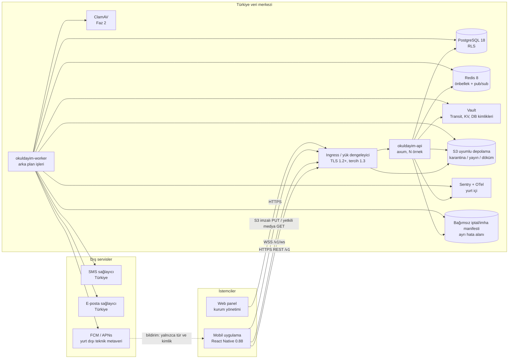
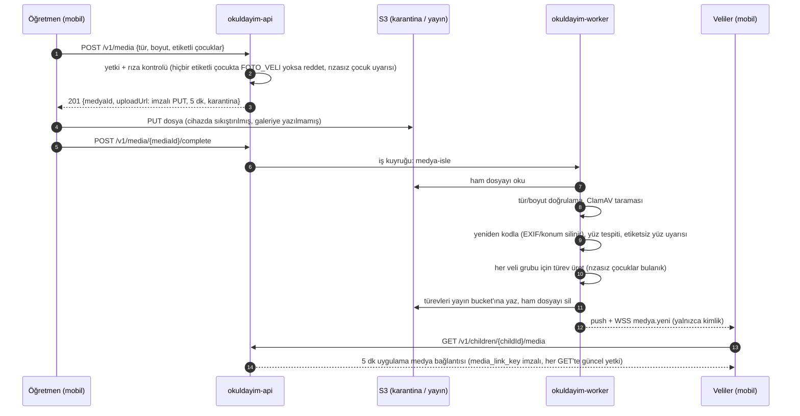
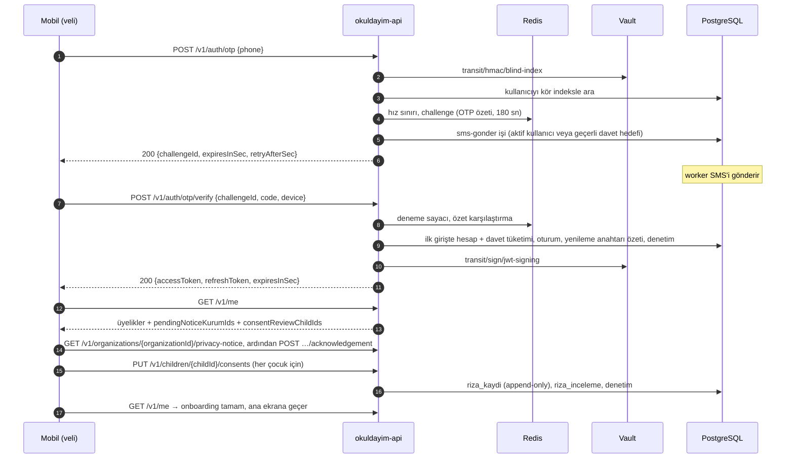
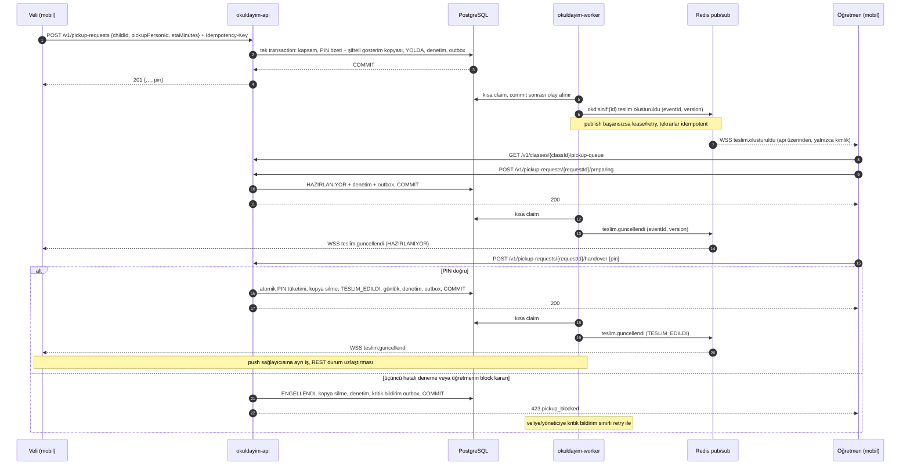

# Okuldayım Backend İhtiyaç Analizi (Rust)

28 Ekim 2026 · Sürüm 1.2 · Durum: uygulanacak tasarım · Kapsam: backend servisleri, mobil istemciyle bağlantı ve kullanım akışları

İlgili belgeler: [Ürün gereksinimleri v1.2](../school-parent-communication-requirements.md) · [Altyapı](../infra/README.md) · [Mobil uygulama](../mobile/README.md)

Bağımlı sistemlerin ayrı analizleri ve birlikte rafine edilen kabul koşulları: [Sistem ihtiyaç analizleri](systems/README.md). Bu depoda Rust backend workspace'i ve üretim ortamı henüz yoktur; aşağıdaki teknoloji, API, test ve işletim tasarımı uygulama hedefidir. Mevcut Compose ve mobil mock ile hedef arasındaki farklar ayrıca belirtilir.

## İçindekiler

1. [Amaç ve kapsam](#1-amaç-ve-kapsam)
2. [Teknoloji seçimi: Rust](#2-teknoloji-seçimi-rust)
3. [Mimari](#3-mimari)
4. [Backend fonksiyonel gereksinimleri](#4-backend-fonksiyonel-gereksinimleri)
5. [Veri modeli](#5-veri-modeli)
6. [API sözleşmesi](#6-api-sözleşmesi)
7. [Mobil istemciyle bağlantı: nerede, nasıl](#7-mobil-istemciyle-bağlantı-nerede-nasıl)
8. [Adım adım kullanım](#8-adım-adım-kullanım)
9. [Fonksiyonel olmayan gereksinimlerin karşılığı](#9-fonksiyonel-olmayan-gereksinimlerin-karşılığı)
10. [Altyapıya gereken eklemeler](#10-altyapıya-gereken-eklemeler)
11. [Test stratejisi](#11-test-stratejisi)
12. [Yol haritası](#12-yol-haritası)
13. [Riskler ve açık sorular](#13-riskler-ve-açık-sorular)
14. [Birleşik inceleme ve kabul](#14-birleşik-inceleme-ve-kabul)

---

## 1. Amaç ve kapsam

Backend; mobil uygulamanın ve kurum web panelinin tek veri kaynağıdır. Kimlik doğrulama, yetkilendirme, kiracı izolasyonu, KVKK kuralları (rıza, saklama, imha, başvuru), canlı olaylar, bildirimler ve medya işleme backend'in sorumluluğundadır.

**Başlangıç noktası.** Mobil uygulama bugün bellek içi bir mock sunucuyla çalışıyor. Backend'in ilk hedefi mevcut kullanıcı akışlarını gerçek veriyle karşılamaktır. İngilizce yollar ve aşağıda belirtilen DTO eklemeleri istemci/mock/sözleşme testlerine birlikte uygulanır; mevcut mock tüm MVP'nin uygulanmış sözleşmesi sayılmaz:

| Referans | Konum | Backend için anlamı |
| --- | --- | --- |
| API tipleri | `mobile/src/core/api/types.ts` | JSON alan adları ve şekilleri (camelCase) |
| Uç noktalar | `mobile/src/core/api/endpoints.ts` | Mevcut mock yolları, metot, gövde |
| Hata modeli | `mobile/src/core/api/errors.ts` | Hata kodları ve HTTP durumları |
| Davranış | `mobile/src/core/api/mock/mockServer.ts` | Kurallar (kapsam, en kısıtlayıcı rıza, PIN, OTP sınırları) |
| Davranış testleri | `mobile/src/core/api/mock/__tests__/mockServer-test.ts` | Backend'e karşı da koşacak sözleşme senaryoları |

**Fazlar.**

| Faz | Kapsam | Pilot öncesi zorunlu mu |
| --- | --- | --- |
| 1a | İskelet, platform katmanı, davet/kimlik, `/v1/me`, aydınlatma ve rıza, günlük akış, öğün, teslim; seed/yönetim aracı | Evet |
| 1b | Canlı bağlantı (WebSocket), push, cihaz yönetimi, KVKK başvurusu, saklama ve imha işi, erişim kısıtlaması | Evet |
| 2 | Medya, aktivite/bakım, duyuru, mesajlaşma, yoklama, takvim, yetkili kişi daveti/kullanıcı kapsamı, veri dökümü, tam kurum yönetimi API'si ve MFA | Evet (MVP kapsamı) |
| 3 | Gelişmiş rapor/PDF, özellik bayrakları paneli, kriptografik imha ve acil erişim iş akışının otomasyonu; §4.1'deki S/C maddeleri | Hayır; temel imha ve onaylı işletim süreçleri pilot öncesi zorunlu |

Faz ataması ürün MoSCoW önceliğini izler: M maddeleri pilot öncesi fazlardadır; C maddeleri (ör. NOT-03 SMS yedeği, PICK-09 "yaklaştı") pilot kapısını bekletmez. §4'te faza bağlanmayan S/C maddeleri §4.1'de listelenir.

**Kapsam dışı:** ödeme, servis konum takibi, e-Okul/MEB entegrasyonu, canlı kamera, yapay zekâ ile yüz tanıma (gereksinim analizi bölüm 1).

**Taşıma kararı:** Mobil/web API REST/JSON ve OpenAPI kullanır; canlı olaylar WebSocket JSON'dur. Protobuf bir veri serileştirme biçimidir, REST'in doğrudan alternatifi değildir. Mevcut mobil taşıyıcı ve modüler monolit için gRPC/Protobuf geçişini gerektiren ölçülmüş bir ihtiyaç yoktur. Ayrı servisler oluşursa iç iletişim için payload, CPU, gecikme ve işletim maliyeti ölçülerek değerlendirilir.

---

## 2. Teknoloji seçimi: Rust

**Neden Rust.**

- **Güvenlik:** Bellek ve veri yarışı hatalarını azaltır. Yetkilendirme, iş mantığı, sır yönetimi ve KVKK uygunluğu ayrıca tasarlanıp test edilir; dil seçimi bunları tek başına sağlamaz.
- **Performans:** Düşük ve öngörülebilir gecikme, sabah girişi ve 16:00–18:00 teslim saatlerindeki 10× yük için az kaynakla yatay ölçekleme.
- **Tek dil:** API, arka plan işleri, medya işleme ve araçlar aynı kod tabanında.

**Bedeli:** Ekibin Rust yetkinliği, daha uzun derleme süreleri ve medya/model bağlamalarının olgunluğunu doğrulama ihtiyacı. Önlemler bölüm 13'te.

**Bileşenler:** Aşağıdaki kütüphaneler aday seçimlerdir; depoda `Cargo.toml`/`Cargo.lock` olmadığı için belirli sürümlerin güncel veya birbiriyle uyumlu olduğu henüz doğrulanmış değildir. Backend iskeletinde MSRV, uyum, lisans ve güvenlik kontrolünden geçen sürümler `Cargo.lock` ve `rust-toolchain.toml` ile sabitlenir. Compose imajlarının etiket/digest ve desteği de ayrı doğrulanır.

| Katman | Seçim | Gerekçe |
| --- | --- | --- |
| Dil | Rust 2024 edition, doğrulanmış kararlı toolchain | CI ve yerel geliştirme aynı toolchain'i kullanır |
| HTTP ve WebSocket | axum, tower, tower-http | Tokio ekosistemi; zaman aşımı, gövde sınırı, iz ve sıkıştırma |
| Async çalışma zamanı | tokio | Blocking CPU işleri sınırlı worker havuzuna alınır |
| Veritabanı | PostgreSQL (yerel Compose: 18), sqlx | Parametreli sorgular; query macro kullanılıyorsa `cargo sqlx prepare` ile çevrimdışı CI metaverisi |
| Migration | sqlx migrate (ayrı `okuldayim-migrate` ikilisi) | Şema sahibi rolle çalışır (bkz. 3.4) |
| Önbellek ve pub/sub | redis crate (ConnectionManager) | OTP sayaçları, hız sınırı, üyelik ipuçları, canlı olay dağıtımı |
| Sır ve anahtar | vaultrs | Barındırmaya uygun workload girişi, KV v2, Transit, dinamik DB kimlikleri |
| Nesne depolama | aws-sdk-s3 1.x | RustFS / S3 uyumlu, path-style, imzalı URL |
| JWT | jsonwebtoken | ES256 doğrulama; Vault Transit JWS imzasıyla entegrasyon testi |
| Kriptografi yardımcıları | hmac, sha2, rand, secrecy, zeroize | CSPRNG, pepper'lı HMAC, sırların loglardan saklanması; bellek kopyaları ayrıca değerlendirilir |
| Girdi doğrulama | garde | DTO uzunluk, aralık, enum ve toplam batch sınırları |
| Hata modeli | thiserror | |
| Zaman | jiff | `Europe/Istanbul` gün sınırları; kaydedilen anlar UTC |
| OpenAPI | utoipa, utoipa-axum | Sözleşme koddan üretilir; mobil tipleri bundan türetilir |
| Log, iz, hata izleme | tracing, tracing-subscriber, opentelemetry, sentry | Yurt içi Collector ve Sentry; kaynakta veri ayıklama |
| Metrik | metrics, metrics-exporter-prometheus | Sınırlı cardinality; kişisel kimlikler label olmaz |
| HTTP istemcisi | reqwest | Sağlayıcı timeout, retry ve bağlantı havuzu |
| Push | Android FCM HTTP v1; iOS APNs HTTP/2; OAuth için gcp_auth adayı | Expo native token'ları platformuna uygun sağlayıcıya yönlendirilir; Expo Push kullanılmaz |
| E-posta | lettre | E-posta OTP alternatifi; geliştirmede Mailpit |
| Görüntü işleme | image, imageproc, ort + doğrulanmış yüz tespit modeli; video codec hattı | Lisans/uyum ve kalite eşikleri ayrıca doğrulanır; yüz tanıma yok |
| Test | sqlx::test, testcontainers | İzole PostgreSQL ve Redis/Vault entegrasyonları |
| Derleme ve tedarik zinciri | cargo-chef, cargo-deny, cargo-audit | Docker katman önbelleği; lisans, güvenlik açığı ve yasaklı bağımlılık kontrolü |

---

## 3. Mimari

### 3.1 Bağlantı topolojisi



- Mobil istemci REST (`https://api.<alan>/v1`), WebSocket (`wss://api.<alan>/v1/ws`) ve medya (`https://medya.<alan>`) kullanır. PUT S3 imzasıyla, özel GET ise uygulama imzası ve her istekte güncel yetki denetleyen medya geçidiyle çalışır. Ingress GET'i API'ye, imzalı PUT'u S3'e yönlendirir.
- Veritabanı, Redis, Vault ve depolamanın iç adresleri internete kapalıdır. Depolamaya dışarıdan yalnızca imzalı URL ile ve yalnızca ingress üzerinden erişilir.
- FCM/APNs'e içerik metni gönderilmez; cihaz belirteci, opak referans ve teknik metaveri takma kimlikli kişisel veri olabilir. Alt işleyen/SDK/auto-unseal dahil bütün dış servis akışları hukukça değerlendirilir; iç sistemlerin yurt içi konumu push için aktarım yükümlülüğünü ortadan kaldırmaz.
- İptal başarı yanıtı ve fiziksel imha, bağımsız manifest deposunun kalıcı yazma onayını bekler (BK07). Aynı depo denetim zincirinin günlük imzalı checkpoint'lerini tutar (§3.13).

### 3.2 Modüler monolit: Cargo workspace

Gereksinim analizindeki modüler monolit önerisi korunur; modül sınırları crate sınırlarıyla denetlenir.

```
backend/
├── Cargo.toml                  # workspace, ortak bağımlılık sürümleri
├── rust-toolchain.toml
├── deny.toml                   # cargo-deny: lisans, güvenlik açığı, yasaklı crate
├── migrations/                 # sqlx migration'ları (şema + RLS politikaları)
├── crates/
│   ├── platform/               # ortak altyapı (diğer modüllere bağımlı değil)
│   │   ├── config, db (TenantTx), vault, redis, s3
│   │   ├── auth (JWT doğrulama, AuthContext), yetki matrisi
│   │   ├── hata modeli (ApiError → {error:{code,details}})
│   │   ├── denetim kaydı, idempotency, iş kuyruğu, canlı olay yayını
│   │   └── log maskeleme
│   ├── identity/               # AUTH: OTP, oturum, yenileme, cihaz, hesap silme
│   ├── organization/           # ORG: kurum, şube, sınıf, çocuk, üyelik, erişim kısıtlaması
│   ├── privacy/                # KVKK: aydınlatma, rıza, başvuru, veri dökümü, saklama-imha
│   ├── daily/                  # ACT/MEAL/CARE/ATT/CAL: günlük kayıt, menü, yoklama, takvim
│   ├── pickup/                 # PICK: yetkili kişi, teslim talebi, PIN
│   ├── media/                  # MED (Faz 2)
│   ├── communication/          # ANN/MSG (Faz 2)
│   └── notification/           # NOT: push, SMS, e-posta, uygulama içi bildirim
└── apps/
    ├── api/                    # okuldayim-api: REST + WebSocket sunucusu
    ├── worker/                 # okuldayim-worker: arka plan işleri
    ├── migrate/                # okuldayim-migrate: şema migration'ları
    └── seed/                   # okuldayim-seed: sentetik demo verisi (yalnızca geliştirme/test)
```

Kurallar:

- Modüller birbirinin tablosuna doğrudan erişmez; dışa açık servis trait'leri ve alan olayları kullanılır. Örnek: `daily`, rızayı `privacy::ConsentQuery` üzerinden sorar. Ortak transaction'a katılım API'de açıkça taşınır; farklı havuzlarda açılan transaction'lar tek atomik işlem sayılmaz.
- Bağımlılık yönü: `apps → modüller → platform`. Modüller arası döngü yasaktır (workspace içi bağımlılık grafiği CI'da kontrol edilir).
- Tüm crate'lerde `#![forbid(unsafe_code)]`; `clippy -D warnings`.
- İleride bir modülü ayrı servise çıkarmak gerekirse (ör. medya işleme), sınır zaten crate olarak hazırdır.

### 3.3 İstek yaşam döngüsü

1. **Ingress:** TLS 1.2+ sonlanır; doğrulanmış/sınırlandırılmış istek kimliği kullanılır. `X-Forwarded-*` ve gerçek IP yalnızca güvenilen proxy'den alınır.
2. **tower katmanları:** istek kimliği, zaman aşımı (10 sn), JSON gövde sınırı (1 MB; medya doğrudan depolamaya gider), CORS (yalnızca web panel kaynağı; mobil için gerekmez), sıkıştırma, iz kaydı (gövde ve sorgu dizesi loglanmaz), Redis tabanlı hız sınırı.
3. **`AuthContext` çıkarıcı:**
   1. İmza, sabit ES256 algoritması, `iss`, `aud`, `exp`/`nbf` ve saat sapması doğrulanır. Bilinmeyen `kid` yenilemesi hız sınırlıdır.
   2. Redis oturum/üyelik ipuçları 30/60 sn tutulabilir; nihai oturum iptali ve aktif üyelik kontrolü PostgreSQL'den yapılır. Eski cache erişim yetkisi oluşturmaz.
   3. İstek hedefi için tek kurum ve kullanıcı kapsamı sunucuda belirlenir; rıza/sınıf/çocuk yetkisi transaction içinde güncel kayıttan doğrulanır.
4. **Handler → servis:** yetki matrisi ve kapsam kontrolü (`yetkilendir(ctx, Eylem, Kapsam)`), ardından gerekiyorsa rıza kontrolü.
5. **`TenantTx`:** transaction açılır, oturum değişkenleri `set_config(..., true)` ile yazılır (bkz. 3.4). Sorgular RLS altında çalışır. Denetim kaydı ve iş kuyruğu kaydı aynı transaction'da yazılır, ardından commit edilir.
6. **Commit sonrası:** aynı transaction'da kalıcı outbox'a yazılan olay worker tarafından yeniden denenerek Redis Pub/Sub'a yayınlanır. Abone kayıpları için REST uzlaştırması kullanılır (§3.9).
7. **Yanıt:** JSON, `Cache-Control: no-store`, `X-Request-Id`. HTTP no-store cihazın uygulama içi cache/şifreli DB'sini yönetmez; bu katmanlar veri minimizasyonu ve oturum kapanışında silme uygular.

### 3.4 Kiracı izolasyonu ve veritabanı rolleri

Altyapıdaki rol modeli (`infra/postgres/initdb/01-roles.sh`) başlangıçtır; aşağıdaki ayrımlar migration ve üretim kimlikleriyle tamamlanır:

| Rol | Kim kullanır | Yetki |
| --- | --- | --- |
| `okuldayim_owner` | — (giriş yapamaz) | Şema ve tabloların sahibi |
| `okuldayim_migrator` | `okuldayim-migrate` | Bağlantı açılınca `SET ROLE okuldayim_owner` çalıştırır; nesneler owner adına oluşur |
| `okuldayim_app` | `okuldayim-api`, `okuldayim-worker` (Vault'un ürettiği kısa ömürlü kullanıcılar bu gruba üyedir) | Tablo sahibi değil, `BYPASSRLS` yok, DDL yapamaz |
| Ayrı retention/provisioning kimlikleri | Süre sonu silme ve kurum anahtarı kurulumu | Kurum kapsamlı dar yordam/iş yetkisi; ordinary API'ye denetim silme veya anahtar imha yetkisi verilmez |

Her kiracı tablosunda RLS açılır ve zorlanır. Oturum değişkeni ayarlanmamışsa politika satır döndürmez (varsayılan kapalı):

```sql
ALTER TABLE app.cocuk ENABLE ROW LEVEL SECURITY;
ALTER TABLE app.cocuk FORCE ROW LEVEL SECURITY;

CREATE POLICY kiraci ON app.cocuk
  USING (kurum_id = NULLIF(current_setting('app.kurum_id', true), '')::uuid)
  WITH CHECK (kurum_id = NULLIF(current_setting('app.kurum_id', true), '')::uuid);
```

```rust
/// Bağlam, PostgreSQL'den doğrulanmış aktif üyeliğin seçili kurumunu taşır.
pub async fn begin_tenant<'a>(pool: &'a PgPool, ctx: &AuthContext) -> Result<Transaction<'a, Postgres>, ApiError> {
    let mut tx = pool.begin().await?;
    sqlx::query("SELECT set_config('app.user_id', $1, true), set_config('app.kurum_id', $2, true)")
        .bind(ctx.user_id.to_string())
        .bind(ctx.organization_id.to_string())
        .execute(&mut *tx)
        .await?;
    Ok(tx)
}
```

- RLS kurum düzeyinde sızıntıyı engeller; sınıf ve çocuk düzeyindeki kapsam (öğretmen yalnızca kendi sınıfı, veli yalnızca kendi çocuğu) servis katmanında kontrol edilir ve her uç nokta için otomatik testle doğrulanır.
- Yukarıdaki kod hedef tasarım örneğidir. Kurum/şube dahil kiracı tabloları, birleşik FK'lar ve yanlış/eksik bağlam testleri zorunludur. `/v1/me` gibi kurumlar arası kullanıcı özeti ve worker queue claim işlemi özel kapsamlı yordamlarla sınırlandırılır; sıradan transaction'a tüm kurumlar eklenmez.
- Denetim ve rıza tablolarında `okuldayim_app` için yalnızca `INSERT` ve `SELECT` vardır (append-only).
- **Dinamik kimlik bilgileri:** api/worker `database/creds/okuldayim-app` ile havuz kurar. Vault token yeniden auth ve DB lease yenileme ayrı yönetilir; max TTL veya yenileme hatasından önce yeni kimlik/havuz hazırlanır, trafik geçirilir ve eski havuz lease dolmadan boşaltılır. Rotasyondaki iki havuz toplam bağlantı bütçesine dahildir; eski rol/bağlantı iptali entegrasyon testiyle kanıtlanır.

### 3.5 Kimlik doğrulama ve oturum

**SMS OTP (AUTH-01/02):**

1. `POST /v1/auth/otp` telefonu E.164'e normalize eder. Kör indeks (Vault Transit HMAC, anahtar `blind-index`) ile aktif kullanıcıyı veya süresi geçmemiş davet hedefini arar.
2. Numara kayıtlı olsun olmasın aynı yanıt aynı sürede döner (kullanıcı varlığı sızdırılmaz). SMS yalnızca aktif kullanıcıya veya geçerli davet hedefine, iş kuyruğu üzerinden gönderilir.
3. Kod 6 haneli ve CSPRNG ile üretilir. Redis'e yalnızca `HMAC-SHA256(pepper, challengeId ‖ kod)` yazılır (TTL 180 sn). Pepper Vault KV'dedir (`secret/okuldayim/backend.otp_pepper`).
4. Sınırlar: kod başına 5 deneme (sonra `otp_locked`), numara başına 10 dakikada 3 kod, IP başına 10 dakikada 10 istek; 429 yanıtında `Retry-After` başlığı.

Challenge doğrulama/deneme artışı/tüketimi atomiktir. Redis kaybında yeni OTP işlemleri güvenilir sayaç yedeği veya geçiş kısıtlaması olmadan açılmaz. SMS işi 180 sn geçerlilik içinde gönderilir; kuyruk gecikmesiyle süresi dolan kod iptal edilir. Gönderilecek OTP'nin geçici şifreli iş verisi en geç geçerlilik sonunda silinir.

**Davet ve e-posta alternatifi:** `davet` kaydı kurum, rol, kapsam (sınıf/çocuk), telefon/e-posta hedefinin kör indeksi ve şifreli değeri, token özeti, 7 günlük süre ve atomik tüketim içerir. Hesap yalnız davetle oluşur: hedef ilk kez OTP ile doğrulandığında hesap açılır ve o hedefe ait süresi geçmemiş davetler aynı transaction'da üyeliğe dönüşür. Bağlantıdaki token uygulamayı doğru akışa yönlendirir; oturum açıkken gelen yeni kurum/çocuk daveti `POST /v1/invitations/redeem` ile kabul edilir. Token tek başına oturum açmaz ve hedef dışındaki hesaba bağlanamaz. AUTH-01 e-posta alternatifi Faz 1a'da ayrı challenge yoluyla aynı deneme/TTL kurallarını uygular; telefon ve e-posta kimliği yalnız ikisi de doğrulanmışsa aynı hesapta birleşir. Mevcut mobil UI ve mock yalnız telefon OTP'si uygular; e-posta/davet istemci akışı henüz eklenmemiştir.

**Anahtarlar:**

| Anahtar | Biçim | Ömür | Saklama |
| --- | --- | --- | --- |
| Erişim (access) | JWT, ES256, Vault Transit `jwt-signing` ile imzalı | 15 dk | Mobilde yalnızca bellekte |
| Yenileme (refresh) | 256 bit rastgele, opak | 30 gün (her kullanımda döner) | Sunucuda yalnızca SHA-256 özeti; mobilde Keychain/Keystore |

- JWT claim'leri `sub`, `sid`, `iat`, `exp`, `iss`, `aud`; `kid` JWS başlığındadır (`jwt-signing:v<sürüm>`). Ad/telefon/içerik taşınmaz; `sub` ve `sid` yine takma kimlikli kişisel veridir. Güncel iptal ve erişim kısıtlaması yeni isteklerde DB kontrolüyle uygulanır.
- Yenileme anahtarı tekrar kullanılırsa (çalınma belirtisi) tüm oturum ailesi iptal edilir (mock sunucuyla aynı davranış).
- Mobil `tokens.ts` yenileme yanıtında `400` veya `401` alınca oturumu bitirir ve şifreli yerel veritabanını, gönderilmemiş kuyrukla birlikte siler (AUTH-07). Bu yüzden `/v1/auth/refresh` yalnız anahtar geçersiz, iptal edilmiş veya yeniden kullanılmışsa `401` döner. Redis, Vault veya DB kesintisinde `503` + `Retry-After` verir; geçici hiçbir durumda `400`/`401` dönmez.
- **Uzaktan oturum kapatma (AUTH-07):** Kullanıcı cihaz listesinden bir cihazı kapatır → oturum iptal edilir → o cihaza WebSocket ile `oturum.sonlandi` gider ve sonraki yenileme 401 döner. Mobil uygulama her iki durumda da yerel veriyi siler (`sessionService.wipeLocalData`).
- **Web panel:** OTP + TOTP, yönetim API'si açılan ilk fazdan itibaren zorunludur. 1a/1b yönetim aracı kullanılıyorsa kişiye bağlı, MFA korumalı operasyon kimliği ve dar kapsam gerekir; ortak root/app kimliği yönetici oturumu değildir. TOTP enrollment/confirm, son kullanılan zaman adımı, şifreli TOTP sırrı, hash'li kurtarma kodları ve denetimli recovery tanımlanır. OTP sonrası oturum MFA tamamlanana kadar yalnız enrollment/verify/recovery yollarına erişir; rol istemciden atanamaz. Kurtarma kodu tek kullanımlıktır; sıfırlama ek kimlik doğrulama, kurum onayı ve mevcut yönetim oturumlarının iptalini gerektirir. `HttpOnly; Secure; SameSite=Strict` çerez + CSRF belirteci, Origin kontrolü ve belirli CORS kaynağı kullanılır.

### 3.6 Yetkilendirme ve rıza kontrolleri

- **Roller:** Mobil `Role` tipindeki `KURUM_YONETICISI`, `OGRETMEN`, `VELI` ve `YETKILI_TESLIM_ALAN` kurum üyelikleridir. Ürün §2'deki diğer iki rolün backend kodları: `KVKK_IRTIBAT` (kurum kapsamlı, yalnız web panel; başvuru, rıza ve imha raporları) ve `PLATFORM_YONETICISI` (kurum üyeliği değildir; kurum açma ve destek, kurum verisine varsayılan erişimi yok, KVKK-11). Bir kullanıcının birden çok kurum/rol üyeliği olabilir; istek bağlamındaki kurum, hedef kaynaktan sunucuda çözülür.
- Yetki matrisi (gereksinim bölüm 2) `platform::yetki` içinde mobildeki `src/core/rbac/permissions.ts` ile aynı eylem adlarıyla tanımlanır. İki taraf, Faz 2'de ortak bir `yetki-matrisi.yaml` dosyasından üretilir; o zamana kadar sözleşme testleri farkı yakalar.
- Rıza sunucuda uygulanır; istemcinin gösterdiği durum yalnızca bilgilendirmedir.

| Rıza | Uygulandığı yer |
| --- | --- |
| `SAGLIK` | Etkin değilse sağlık alanları öğretmene hiç gönderilmez (`allergens: null`); alerjen eşleşmesi yapılmaz. Etkin rıza düştüğünde profil aynı transaction'da erişime kapanır ve `saglik-profili-imha` işi hemen kuyruğa alınır (ürün 6.7: "derhal") |
| `FOTO_VELI` | Etkin değilse çocuğun velilerine o çocuk için medya türevi üretilmez ve çocuk diğer türevlerde bulanıklaştırılır. Etiketli hiçbir çocukta etkin değilse yükleme reddedilir |
| `FOTO_GRUP` | Etkin değilse (veya `FOTO_VELI` etkin değilse) çocuğun yüzü diğer velilere giden türevlerde bulanıklaştırılır; grup videosu yayınlanmaz |
| `FOTO_TANITIM` | Tanıtım dışa aktarımlarına çocuk dahil edilmez |
| `KONUM` | Etkin değilse "yaklaştı" olayı reddedilir (PICK-09, C önceliği; pilot sonrası) |
| `AKIS_YETKILI` | Etkin değilse yetkili teslim alan akışı göremez |

- **Etkin rıza:** Her (çocuk, tür) için tüm velilerin son kararından hesaplanır: en az bir `GRANTED` ve hiç `DENIED` yok (KVKK-04). Hesap bir veritabanı görünümünde tek yerde yapılır ve mobildeki `resolveEffectiveConsent` ile aynı testleri geçer.
- **Erişim kısıtlaması (KVKK-09):** `veli_cocuk.erisim` alanı `TAM`, `SALT_OKUNUR` veya `KAPALI` olur. Değişince üyelik önbelleği silinir ve açık WebSocket bağlantısı yeniden yetkilendirilir.
- Rıza geri alındığında yeni GET/yayın işlemleri hemen güncel kararla denetlenir. `FOTO_GRUP` eski türevi yeniden üretilene kadar erişime kapatılır; asenkron yeniden üretim eski görüntüyü erişilebilir bırakmaz. Ham dosya yayından sonra silindiği için yeniden üretim mevcut türevden ve medya kaydındaki yüz kutularından yapılır: yalnız bulanıklaştırma eklenebilir, sonradan verilen rıza eski bulanık türevleri açmaz. Yüz kutusu koordinattır, biyometrik şablon değildir ve medyayla birlikte imha edilir. Daha önce cihazda alınmış byte'ların geri çekilemeyeceği teknik sınır açıkça belirtilir.
- İptal PostgreSQL'de erişimi hemen kapatır; API başarı ve idempotency başarı replay'i, bağımsız kalıcı iptal manifesti onayını bekler. Manifest kesintisinde kısıt sürer ve işlem yeniden denenir; fiziksel imha manifest onayından sonra yapılır. [BK07](systems/backup-recovery-requirements.md) genel RPO'nun iptalleri/imha kararlarını geri açmamasını sağlar.
- `YETKILI_TESLIM_ALAN` için çocuk/kurum ilişkisi ve süre/kullanım sınırı ayrı yetki kaydıyla tutulur. Faz 2'de teslim talebi oluşturabilir; isteğe bağlı akış okuması `AKIS_YETKILI` ve kapsamla sınırlıdır, sağlık/fotoğraf erişimi verilmez.

### 3.7 Şifreleme ve anahtar kullanımı

| Veri | Yöntem | Vault anahtarı |
| --- | --- | --- |
| Sağlık profili (alerji, kronik durum, ilaç talimatı, diyet kısıtı), ilaç ve olay kayıtlarının ayrıntısı | Transit `encrypt`/`decrypt` (toplu); sınıf listesi tek çağrıda çözülür | `kurum-<uuid>` (kurum açılışında oluşturulur, yıllık otomatik rotasyon) |
| Yetkili/acil kişi telefonu, KVKK başvuru açıklaması, hassas idempotency yanıtı, teslim PIN'inin süreli gösterim kopyası | Transit | `kurum-<uuid>` |
| Kullanıcı telefonu ve e-postası, davet hedefi, push token, TOTP sırrı | Transit | `kullanici-pii` (platform düzeyi; altyapıya eklenecek, bkz. bölüm 10) |
| Telefon/e-postayla arama | Transit HMAC (kör indeks; alan türü ön ekli, sürümlü) | `blind-index` |
| Erişim anahtarı (JWT) | Transit `sign` (`marshaling_algorithm=jws`) | `jwt-signing` (90 günde rotasyon) |
| OTP | HMAC-SHA256 + pepper | KV `otp_pepper` |
| Teslim PIN'i | `HMAC-SHA256(pickup_pepper, requestId ‖ pin)`; karşılaştırma sabit zamanlı | KV `pickup_pepper` |
| Medya ve döküm indirme bağlantısı | HMAC-SHA256 imzalı uygulama bağlantısı; ≤ 5 dk, oturum + kaynak + türev kimliğine bağlı | KV `media_link_key` (sürümlü; eski sürüm en çok bağlantı ömrü kadar doğrular) |
| Denetim zinciri checkpoint'i | Transit `sign` | `denetim-checkpoint` (JWT anahtarından ayrı) |
| Yenileme anahtarı | Yüksek entropili rastgele token'ın SHA-256 özeti | — |
| Medya | Özel bucket, sunucu tarafı şifreleme, kurum ön eki (`<kurumId>/…`) | — |

- Runtime sırlarının kaynağı Vault'tur; üretimde imaj/kaynak/env dosyasına sabit sır yazılmaz. Workload kimliği veya kısa ömürlü güvenli mount kullanılır. Yerel Compose servis sırlarını `.env` üzerinden alır; bu mevcut geliştirme istisnasıdır.
- Dört haneli PIN'in tuzlu hızlı hash'i veritabanı kopyasını ele geçiren kişiye karşı yeterli değildir; pepper Vault'ta ayrı korunur. HMAC/PIN sürümü, süre, üç deneme ve tüketim kontrolü birlikte uygulanır.
- **Kriptografik imha:** Kurum anahtarı yalnız hukuki muhafaza ve saklama yükümlülüğü bitince, onaylı ve dar kapsamlı operasyonla silinir; temel süreç pilot öncesi, panel otomasyonu Faz 3'tür. Bu anahtar yalnız onunla şifreli alanları etkiler; ortak `kullanici-pii` verisi, medya nesneleri ve eski Vault yedekleri ayrıca silme/manifest politikasına tabidir.

### 3.8 Çevrimdışı istemci desteği ve idempotency

Mobil uygulama öğretmen girişlerini önce şifreli yerel kuyruğa yazar ve her isteğe `Idempotency-Key` (UUID) ekler (`mobile/src/core/offline/outbox.ts`). Backend tarafı:

1. Retry edilebilir yazmalarda (çevrimdışı kuyruk ve teslim talebi oluşturma) `(kurum_id, kullanıcı, HTTP metodu, yol şablonu/hedef, anahtar)` benzersizdir. Gövde özeti kanonik biçim üzerinden hesaplanır.
2. Kayıt yoksa istek işlenir; idempotency kaydı iş, outbox ve yanıtla aynı transaction'da yazılır. Aynı anahtarla eşzamanlı gelen ikinci istek, ilk transaction'ın unique kaydını `lock_timeout` sınırında bekler. İlk commit ederse saklanan sonucu alır, ilk geri alınırsa kendisi işlenir, süre aşılırsa `503 server` + `Retry-After` döner. Mobil kuyruk `503`'ü yeniden dener, `409`'u ise kalıcı hata sayar. BK07 iptalinde işlem tamamlanması ve başarı replay'i bağımsız manifest onayına bağlıdır; onay gelmeden kayıt `pending` kalır ve tekrar gelen istek manifest yazımını yeniden dener.
3. Aynı anahtar ve aynı gövde özetiyle gelen tekrar, saklanan yanıtı döner ve yeniden işlenmez. Yalnız commit edilen `2xx` sonuç saklanır; hata yanıtı durum değiştirmediği için saklanmaz ve tekrar güncel durumla değerlendirilir. Mevcut mock `500` altındaki bütün yanıtları saklar; sözleşme testleri yalnız `2xx` replay'ini sabitler.
4. Aynı anahtar farklı gövdeyle gelirse `409 conflict` (`details.reason: "idempotency_mismatch"`) döner.
5. Metaveri 7 gün tutulur; hassas yanıt şifrelenir ve her replay'de güncel yetki/retention kontrol edilir. Teslim PIN'i genel 7 günlük kayda yazılmaz; talep sahibine gösterim kuralı §3.14'tedir.

**Sözleşme eklemesi: öğün zamanı.** `MealEntryPayload.recordedAt` henüz mobilde yoktur; optional ISO 8601 alan olarak eklenir, sunucu ayrıca `receivedAt` kaydeder.

- Kayıt günü her zaman payload `date`'tir; istemci bunu sunucunun `today` yanıtından alır. Mevcut mock `date`'i yok sayıp sunucu gününe yazar; bu fark sözleşme testinde kapatılır.
- `recordedAt` yoksa an olarak `receivedAt` kullanılır ve `zamanKaynagi = SUNUCU` işaretlenir.
- Zaman tutarsızlığı kaydı reddetmez, çünkü reddedilen kuyruk kaydı mobilde kalıcı hata olur ve veri kaybolur. İleri tarihli `recordedAt`, `receivedAt`'e çekilir. `date` ile farklı yerel gün veya 12 saati aşan gecikme `GEC_KAYIT` işaretiyle `date` gününe yazılır ve öğretmen/yönetici incelemesine düşer. Kayıt sessizce başka güne taşınmaz.
- Aynı çocuk, gün ve öğün için daha yeni olay zamanı kazanır; gecikmeli gelen eski kayıt mevcut kaydı ezmez, geçmiş olarak saklanır.
- İstemci `mealEntry.ts`/`meals.tsx` eklemesi ve testleri tamamlanmadan senaryolar `recordedAt`'i uygulanmış saymaz.

### 3.9 Canlı bağlantı (WebSocket)

Teslim bildiriminin öğretmene 5 sn içinde ulaşması (gereksinim 5) yoklamayla (bugünkü 10 sn) karşılanamaz; bu yüzden Faz 1b'de WebSocket gelir.

- **Adres:** `wss://api.<alan>/v1/ws`.
- **Kimlik doğrulama:** İstemci bağlandıktan sonra 5 sn içinde ilk mesajda anahtarı gönderir. Anahtar URL'ye yazılmaz, çünkü URL'ler loglanır.
- **Abonelik:** Kanalları istemci seçmez; sunucu üyeliklere göre belirler. Böylece başka kurumun kanalına abone olmak mümkün değildir. Redis kanalları: `okd:sinif:<id>`, `okd:cocuk:<id>`, `okd:kullanici:<id>`.
- **Mesajlar:** Yalnızca kimlik ve durum taşır, ad veya sağlık bilgisi taşımaz. İstemci ayrıntıyı REST ile çeker ve yetki her seferinde yeniden kontrol edilir.

| Yön | Mesaj | Kime |
| --- | --- | --- |
| İstemci → sunucu | `{"type":"auth","token":"<jwt>"}` (bağlantı başında ve anahtar süresi bitmeden) | — |
| İstemci → sunucu | `{"type":"ping"}` (25 sn'de bir) | — |
| Sunucu → istemci | `{"type":"ready"}` | Doğrulanan bağlantı |
| Sunucu → istemci | `{"type":"teslim.olusturuldu","eventId":"…","version":1,"classId":"…","requestId":"…"}` | Sınıf öğretmenleri |
| Sunucu → istemci | `{"type":"teslim.guncellendi","eventId":"…","version":2,"requestId":"…","status":"HAZIRLANIYOR"}` | Talebi oluşturan kullanıcı ve sınıf öğretmenleri |
| Sunucu → istemci | `{"type":"akis.yeni","eventId":"…","childId":"…","date":"2026-10-28"}` | Çocuğun erişimi açık velileri |
| Sunucu → istemci | `{"type":"uyelik.degisti","eventId":"…"}` | Üyeliği veya erişimi değişen kullanıcının cihazları; istemci `/v1/me`'yi yeniler ve kapsam dışı kalan yerel veriyi siler (AUTH-07) |
| Sunucu → istemci | `{"type":"oturum.sonlandi"}` | İptal edilen oturumun cihazı |
| Sunucu → istemci (Faz 2) | `medya.yeni`, `mesaj.yeni`, `duyuru.yeni`, `bildirim.yeni`; aynı biçimde yalnız kimlik ve sürüm | Kapsamdaki kullanıcılar |

Alan adları REST DTO'larıyla aynıdır (İngilizce camelCase: `classId`, `requestId`, `childId`, `status`); `type` değerleri sabit olay kodlarıdır. PIN, ad ve sağlık bilgisi hiçbir olayda yer almaz.

- **Dayanıklılık:** Outbox olayında eventId ve kaynak sürümü bulunur; istemci duplicate'leri atar. Kopunca jitter'lı üstel beklemeyle yeniden bağlanır; aktif teslim ekranı en çok 5 sn, diğer açık ekranlar en çok 60 sn'de REST ile uzlaşır. Pub/Sub kaybı bağlantı açıkken de olabildiğinden bu sorgu yalnız kopma durumuna bağlı değildir. JWT süresi bitince bağlantı yeniden auth olur veya kapatılır; iptal/üyelik değişiminde abonelikler yeniden kontrol edilir. İlk auth ≤ 5 sn, ping 25 sn, ingress idle timeout ≥ 90 sn; bağlantı ve mesaj boyutu kotaları uygulanır.

### 3.10 Push bildirimleri

1. **Cihaz kaydı:** Mobil uygulama `expo-notifications` ile yerel belirteci alır (`getDevicePushTokenAsync`): Android FCM kayıt token'ı, iOS APNs device token'ı. `POST /v1/devices` platform, sağlayıcı, token türü ve uygulama/ortam bilgisiyle kaydeder; belirteç `kullanici-pii` anahtarıyla şifreli saklanır. Bunlar mevcut mobilde uygulanmamış DTO/SDK eklemeleridir.
2. **Gönderim:** Push yalnızca worker'dan; Android'e FCM HTTP v1, iOS'a doğrudan APNs HTTP/2 ile gönderilir. Yerel APNs token'ı FCM kayıt token'ı değildir ve FCM'ye gönderilmez. APNs topic/bundle kimliği, sandbox/production yönlendirmesi ve `.p8` imza anahtarı Vault'ta yönetilir; gerçek cihazda push entitlement/izin ve test build'i doğrulanır.
3. **İçerik (KVKK-13):** Başlık genel ve yerelleştirilmiştir; veri yalnızca tür/opağı referansı taşır. Cihaz token'ı ve referans anonim sayılmaz; sağlayıcıya aktarılan metaveri hukuk envanterine girer. Açılınca ayrıntı güncel yetkiyle REST'ten çekilir; sağlık/çocuk adı/OTP/PIN push'a yazılmaz.
4. **Expo Push servisi kullanılmaz:** Bildirim içeriğini ek bir yurt dışı alt işleyenden (Expo sunucuları) geçirir. Doğrudan FCM/APNs kullanımı alt işleyen sayısını bir azaltır.
5. **Kategoriler (NOT-02):** Teslim, kaza ve ilaç bildirimleri kullanıcı tarafından kapatılamaz; diğerleri kategori bazlı kapatılabilir.
6. **SMS yedeği (NOT-03, C önceliği; pilot sonrası):** Kritik bildirim belirli süre okunmazsa kişisel veri içermeyen SMS gönderilir. Pilot öncesi fazlar bu özelliğe bağlı değildir.
7. Sağlayıcı kabulü, cihaza teslim ve kullanıcı okuması ayrı durumlardır. 429/5xx/timeout için sınırlı retry, token geçersizliğinde cihaz belirteci temizliği ve mükerrer gönderim/hacim kotası vardır; push teslimi < 5 sn garanti edilmez.

### 3.11 Medya hattı (Faz 2)



- Upload intent boyut, tür, checksum ve sunucu object key'i içerir; tamamlanma HEAD ile doğrulanır. Rıza yüklemede, işleme/yayın öncesinde ve her GET'te tekrar kontrol edilir. İş tamamlanınca ham nesne silinir; kalan dosyaları worker en çok 24 saatlik sınırla temizler. Mevcut S3 `Days: 1` yaşam döngüsü asenkrondur, kesin saat garantisi değildir.
- Video: grup videosunda etiketli tüm çocukların `FOTO_GRUP` rızası yoksa yayın engellenir (videoda yüz bulanıklaştırma ilk sürümde yok).
- Kurum ayarı açıksa (MED-05) türevler yönetici onayına kadar `ONAY_BEKLIYOR` durumunda kalır.
- Bütün yüklemeler yayından önce ClamAV ile taranır; görsel/video ayrıca yeniden kodlanır. PDF ve dosya ekleri yeniden kodlanmadığı için tür doğrulaması ve tarama zorunlu kapıdır (bölüm 10).
- MED-06 indirme: kurum ayarı açıksa ve fotoğraftaki bütün etiketli çocuklarda `FOTO_GRUP` etkinse ayrı indirme bağlantısı verilir. Görüntüleme bağlantısı indirme izni sayılmaz; istemcinin kaydetme düğmesini gizlemesi teknik engel değildir ve bu sınır kuruma açıklanır.
- Codec/model/bellek/CPU/süre/zip açılım sınırları ve model belirsizliğinde manuel onay vardır; tarayıcı veya model hatasında yayın kapalı kalır. Tek başına yüz tespit modeli, video transcode ve doğru çocuk–yüz eşlemesini sağlamaz; bunlar ayrı kabul testidir.

### 3.12 Arka plan işleri

İş kuyruğu PostgreSQL'dedir (`is_kuyrugu`, `SELECT … FOR UPDATE SKIP LOCKED`). İş, alan değişikliğiyle aynı transaction'da kuyruğa yazılır (transactional outbox); ek bir mesaj kuyruğu sunucusu gerekmez. Zamanlanmış işin tek örnekte çalışması `zamanlanmis_is` lease satırıyla veya transaction düzeyindeki `pg_try_advisory_xact_lock` ile sağlanır. Session düzeyindeki advisory lock, transaction pooling ve DB kimliği/havuz rotasyonunda güvenilir olmadığı için kullanılmaz. Her çalışma planlanan zaman, başlangıç/bitiş ve sonuçla kaydedilir; worker kapalıyken kaçırılan çalışma yeniden başlatmada bir kez telafi edilir.

İş sahiplenme kısa transaction'da yapılır; harici çağrı boyunca lock tutulmaz. Claim süre aşımı, yeniden alma, en az bir kez çalışma, idempotent handler, jitter'lı sınırlı retry ve operatör hatalı iş listesi gerekir. Queue payload mümkünse yalnız kurum/resource kimliklerini taşır. Başka kullanıcıya işlem yapma yetkisi worker'a sınırsız verilmez. OTP gibi geçici sırlar kısa süreli şifreli alan ve kesin imhayla yönetilir.

| İş | Tetikleyici | Görev | Gereksinim |
| --- | --- | --- | --- |
| `olay-yayini` | Sürekli (outbox) | Commit edilmiş olayları Redis Pub/Sub'a yayınlar; başarısız yayın lease/retry ile tekrarlanır | §3.3, §3.9 |
| `sms-gonder`, `push-gonder`, `eposta-gonder` | Alan olayı | Bildirim gönderimi, yeniden deneme | AUTH-01, NOT-01 |
| `medya-isle` | Yükleme tamamlandı | Tarama, EXIF silme, bulanıklaştırma, türevler | MED-01…04 |
| `medya-temizlik` | Saatlik | Karantina, yarım yükleme, yetim nesne ve geçersiz türevleri en geç 24 saatte siler; S3–DB uzlaştırması | MED-03, S305/S307 |
| `gun-sonu-raporu` | Kurumun gün sonu saati (varsayılan 17:30, `Europe/Istanbul`) | Günlük özet ve push; gün sonu yayın modundaki kurumda günün kayıtlarını yayınlar | ACT-04/05 |
| `teslim-gun-sonu` | Her eğitim günü sonu | Açık `YOLDA`/`HAZIRLANIYOR` talepleri `SURESI_DOLDU` yapar, PIN kopyasını siler | §3.14 |
| `imha` | Her gün 02:00 | Saklama süresi dolan verileri ve 30 günü dolan hesap silme taleplerini siler veya anonimleştirir, imha tutanağı yazar | KVKK-08, AUTH-04, 6.7 |
| `saglik-profili-imha` | Etkin `SAGLIK` rızası düştüğünde | Sağlık profilini aynı gün siler, imha tutanağı yazar | KVKK-02/04, 6.7 |
| `manifest-yeniden-dene` | Sürekli | Onay bekleyen iptal/imha manifest yazımlarını yeniden dener; gecikmede alarm | BK07 |
| `yetkili-kisi-temizlik` | Her gün | Süresi dolan yetkinin fotoğraf ve telefonunu 30 gün sonra siler | PICK-05 |
| `kvkk-hatirlatma` | Her gün | 7/12/14. gün operasyon hatırlatması; 15 gün hedef, 20/27. gün yasal son tarih eskalasyonu | KVKK-05 |
| `veri-dokumu` | Talep | JSON + medya ZIP, 24 saat geçerli uygulama bağlantısı | KVKK-06 |
| `ice-aktarma` | Talep (Faz 2) | CSV/XLSX tarama, önizleme, uygulama ve dosya silme | ORG-05 |
| `duyuru-hatirlatma` | Talep (Faz 2) | Okumayanlara kotalı hatırlatma | ANN-03 |
| `idempotency-temizlik` | Her gün | 7 günden eski kayıtları siler | 3.8 |
| `denetim-zinciri-dogrula` | Her gün | Kurum zincirlerini doğrular, zincir başını imzalayıp bağımsız depoya yazar; bozulmada alarm verir | 6.5, §3.13 |

### 3.13 Gözlemlenebilirlik ve log politikası

- **Loglanmaz:** İstek ve yanıt gövdeleri, sorgu dizeleri, telefon, ad, sağlık verisi, anahtarlar.
- **Loglanır:** İstek kimliği, uç nokta şablonu (`/v1/children/{childId}/feed`), durum kodu, süre, kullanıcı UUID'si.
- Sırlar `secrecy::SecretString` tipinde tutulur; `Debug` çıktısı `[REDACTED]` olur. Ek olarak log katmanında telefon ve e-posta desenleri maskelenir (mobildeki `redact.ts` ile aynı desenler).
- Sentry yurt içinde barındırılır; `send_default_pii = false` ve `before_send` ile ayıklama yapılır.
- **Metrikler:** `http_istek_suresi`, `ws_baglanti_sayisi`, `teslim_bildirim_gecikmesi`, `teslim_engellendi_toplam`, `is_kuyrugu_bekleyen`, `zamanlanmis_is_gecikmesi`, `manifest_onay_suresi`, `vault_cagri_suresi`, `rls_ihlal_denemesi`.
- Operasyon logları en çok 90 gün; iş denetimi ve izinli güvenlik olay kayıtları (Vault audit ve pgaudit dahil) 2 yıl; imha tutanakları 3 yıl tutulur (gereksinim 6.7).
- Kullanıcı UUID/IP/cihaz kimliği takma kimlikli güvenlik verisidir; erişim sınırlıdır. Serbest hata metni veya SQL parametreleri otomatik güvenli kabul edilmez.
- **Denetim zinciri:** Kurum başına tutulur; kurumsuz platform olayları ayrı zincirdir. Zincir başı satır kilidiyle sıralanır; böylece eşzamanlı yazma sırası korunur ve kurumlar arası global kilit oluşmaz. Zincir başı her gün Vault `denetim-checkpoint` anahtarıyla imzalanıp ana DB'den ayrı yetki alanındaki bağımsız depoya (BK07 manifest deposu) yazılır. DB yöneticisinin yeniden yazmasına karşı kanıt bu dış checkpoint'tir. 2 yıllık süre sonu silmesi zinciri son imzalı checkpoint'ten sürdürür.

### 3.14 Teslim durum makinesi

Teslim, yanlış kişiye teslim riskinin en yüksek olduğu akıştır (ürün §10). PICK-04'teki üç durumun yanında iptal, engel ve süre sonu tanımlanmazsa açık veya engellenmiş talep çocuğun sonraki teslimlerini kalıcı olarak bloke eder. Mevcut mock'ta `ENGELLENDI` talep yeni talebi süresiz `409` ile reddeder ve çıkış yolu yoktur.

| Durum | Giriş | İzinli çıkış | PIN |
| --- | --- | --- | --- |
| `YOLDA` | Veli (Faz 2: yetkili teslim kullanıcısı) talebi; seçilen kişi doğrulanmış, geçerli ve kurum ayarı gerektiriyorsa onaylı | `HAZIRLANIYOR`, `TESLIM_EDILDI`, `ENGELLENDI`, `IPTAL`, `SURESI_DOLDU` | Talep sahibine görünür |
| `HAZIRLANIYOR` | Sınıf öğretmeni | `TESLIM_EDILDI`, `ENGELLENDI`, `IPTAL`, `SURESI_DOLDU` | Talep sahibine görünür |
| `TESLIM_EDILDI` | Doğru PIN; atomik tüketim ve akış kaydı | — | Silinir |
| `ENGELLENDI` | Üçüncü hatalı PIN veya öğretmenin "kişi listede değil / kimlik uyuşmuyor" kararı (PICK-07) | `IPTAL` (yalnız kurum yöneticisi, gerekçeli) | Silinir |
| `IPTAL` | Talep sahibinin iptali veya yöneticinin engel çözümü | — | Silinir |
| `SURESI_DOLDU` | Eğitim günü sonunda (`Europe/Istanbul`) açık kalan `YOLDA`/`HAZIRLANIYOR` | — | Silinir |

- Çocuk başına tek açık talep vardır (`YOLDA`, `HAZIRLANIYOR`, `ENGELLENDI`). `ENGELLENDI` gün sonunda süre dolmaz ve yeni talep açarak atlanmaz; yönetici çözümünden sonra yeni talep açılabilir. Her geçiş, denetim kaydı ve outbox olayıyla aynı transaction'dadır.
- PIN 4 hanelidir ve CSPRNG ile üretilir. Doğrulama `HMAC-SHA256(pickup_pepper, requestId ‖ pin)` ve sabit zamanlı karşılaştırmayla yapılır; deneme sayacı ile durum geçişi koşullu UPDATE/satır kilidiyle atomiktir (PG05).
- **PIN gösterimi:** PIN talep sahibine oluşturma yanıtında, replay'de ve talep `YOLDA`/`HAZIRLANIYOR` iken `GET …/pickup-requests/active` yanıtında döner. Mevcut veli ekranı 10 sn'lik yenilemede PIN'i bu GET'ten okur; uygulama yeniden açıldığında da kod kaybolmaz. Bunun için kurum anahtarıyla şifreli gösterim kopyası tutulur ve talep son duruma geçtiği transaction'da silinir. Öğretmen, diğer veli ve yetkili kişi her zaman `pin: null` alır. PIN log, push, WebSocket ve SMS'e yazılmaz.
- Aktif talep GET'i açık talebi veya son 30 dk içinde `TESLIM_EDILDI` olan talebi döner (mock ile aynı; veli son durumu görür); diğer durumda `200 null`. Öğretmen kuyruğu `YOLDA`, `HAZIRLANIYOR` ve çözülmemiş `ENGELLENDI` taleplerini tahmini varışa göre sıralar.
- Tek kullanımlık yetkili kişi hakkı başarılı teslimle aynı transaction'da tüketilir. Teslim kaydı teslim alanın adını ve yakınlığını teslim anındaki kopya olarak tutar ve teslim kayıtlarının süresine tabidir; yetkili kişinin fotoğraf ve telefonu yetki bitimi + 30 gün sonra silinir (PICK-05).
- `IPTAL` ve `SURESI_DOLDU` `PickupStatus` DTO eklemesidir. Mevcut mobil bu değerleri bilmez; çeviri ve kapalı talep görünümü aynı sürümde eklenir, eski istemci için sürüm kapısı uygulanır.
- Gün sonu süre aşımı ve engelin yalnız kurum yöneticisince kapatılması önerilen varsayılandır; pilot kurumlarla onaylanır (§13).

---

## 4. Backend fonksiyonel gereksinimleri

| Kod | Gereksinim | Kaynak | Faz |
| --- | --- | --- | --- |
| BE-KIM-01 | SMS/e-posta alternatifli OTP; atomik tüketim ve deneme/hız sınırları | AUTH-01 | 1a |
| BE-KIM-02 | Davet tabanlı hesap: tek kullanımlık, 7 gün geçerli davet; davetsiz hesap oluşmaz | AUTH-02 | 1a |
| BE-KIM-03 | JWT (15 dk) + dönen yenileme anahtarı; yeniden kullanımda oturum ailesi iptali | AUTH-01, 8 | 1a |
| BE-KIM-04 | Cihaz listesi ve uzaktan oturum kapatma; anlık `oturum.sonlandi` olayı | AUTH-07 | 1b |
| BE-KIM-05 | Hesap silme talebi: 30 gün içinde silme; yasal saklanan kayıtlar kısıtlı erişimle | AUTH-04 | 1b |
| BE-ORG-01 | Kurum açılışı ve Vault'ta kurum anahtarı oluşturma | ORG-01, 6.5 | 1a |
| BE-ORG-02 | Sınıf, çocuk, öğretmen ve veli üyeliği yönetimi; eğitim yılı ve toplu sınıf geçişi; CSV içe aktarma (dosya işlendikten sonra silinir) | ORG-02/05/06 | 2 |
| BE-ORG-03 | Erişim kısıtlaması (velayet kararı); dayanak belge; veliler birbirinin iletişim bilgisini görmez | KVKK-09 | 1b |
| BE-KVKK-01 | Aydınlatma metni sürümleme ve okuma kaydı | KVKK-01 | 1a |
| BE-KVKK-02 | Rıza kaydı (append-only), etkin rıza hesabı (en kısıtlayıcı), metin sürümü değişince yeniden inceleme | KVKK-02…04 | 1a |
| BE-KVKK-03 | Rızanın sunucuda uygulanması (bkz. 3.6) | KVKK-02 | 1a / 2 |
| BE-KVKK-04 | m.11 başvuruları, 30 gün sayaç, hatırlatma, yanıt kaydı | KVKK-05 | 1b |
| BE-KVKK-05 | Veri dökümü | KVKK-06 | 2 |
| BE-KVKK-06 | Saklama politikası ve günlük imha işi, imha tutanağı (3 yıl); sağlık rızası düşünce profilin aynı gün imhası | KVKK-08, 6.7 | 1b |
| BE-KVKK-07 | Kurum onaylı, süreli, denetimli acil erişim prosedürü; otomasyon Faz 3 | KVKK-11 | Pilot öncesi / 3 |
| BE-KVKK-08 | Saklama/hukuki muhafaza sonrası kriptografik imha; otomasyon Faz 3 | 6.7 | Pilot öncesi / 3 |
| BE-GUN-01 | Günlük akış okuma (veli ve öğretmen kapsamıyla) | ACT (§3.3), §2 yetki matrisi | 1a |
| BE-GUN-02 | Toplu öğün kaydı; idempotent; aynı öğün yeniden girilirse güncellenir | MEAL-02…04 | 1a |
| BE-GUN-03 | Menü/alerjen eşleşmesi; Faz 2'de kurum menü yayını ve öğün tanımları | MEAL-01/02/05 | 1a / 2 |
| BE-GUN-04 | Aktivite, uyku, tuvalet, ilaç, olay kayıtları; ilaç ve olay kayıtları değiştirilemez (düzeltme kaydı eklenir) | ACT, CARE | 2 |
| BE-GUN-05 | Gün sonu raporu ve push; kurumun anlık/gün sonu yayın modu | ACT-04/05 | 2 |
| BE-TES-01 | Yetkili kişi listesi; aydınlatma bağlantısı ile kişinin fotoğrafını kendisinin yüklemesi; kurum ayarıyla yönetici onayı (§2 "✓ (onay)") | PICK-05, KVKK-07 | 1a (liste) / 2 (bağlantı, onay) |
| BE-TES-02 | Teslim talebi ve durum makinesi (§3.14): iptal, gün sonu süre aşımı, tek kullanımlık PIN (HMAC + talep sahibine süreli gösterim), 3 hatada veya "kişi listede değil" kararında engel, yönetici çözümü, kritik bildirim | PICK-01…07 | 1a (bildirim 1b) |
| BE-TES-03 | Canlı kuyruk (WebSocket) ve push; teslim olayının akışa yazılması | PICK-03/04 | 1b |
| BE-MED-01 | Medya hattı (bkz. 3.11) | MED-01…07 | 2 |
| BE-ILT-01 | Hedefli duyuru, ek, okundu bilgisi, onay gerektiren duyuru | ANN-01…04 | 2 |
| BE-ILT-02 | Veli ↔ sınıf öğretmenleri ve veli ↔ yönetim konuşmaları; "herkesten gizle"; saklama süresi | MSG-01…05 | 2 |
| BE-BIL-01 | Cihaz kaydı, push, kategori tercihleri; kritik kategoriler kapatılamaz; push'ta yalnız tür ve opak referans | NOT-01/02, KVKK-13 | 1b |
| BE-PLT-01 | Denetim kaydı (özet zinciri), sağlık verisi görüntüleme kaydı, mobil ekran görüntüsü olayı | REP-03, 6.5, KVKK-15 | 1a |
| BE-PLT-02 | Idempotency (bkz. 3.8) | 5 Çevrimdışı | 1a |
| BE-PLT-03 | OpenAPI yayını (`/openapi.json`) | — | 1a |
| BE-PLT-04 | Uzaktan özellik bayrakları (`GET /v1/features`) | 5 Dağıtım | 2 |
| BE-KIM-06 | Yönetici MFA enrollment/recovery ve ayrı yönetim oturumu | 6.5 | Yönetim açılınca |
| BE-KIM-07 | Çok çocuklu/çok kurumlu kullanıcı: `/v1/me` üyelik özeti; istek bağlamındaki kurum hedef kaynaktan sunucuda çözülür | AUTH-03 | 1a |
| BE-PLT-07 | Pilot ve hizmet ölçütleri (kayıt giren öğretmen, raporu açan veli, uygulamadan teslim, duyuru okunma oranı) sunucu kayıtlarından toplu ve anonim üretilir, 5 kişiden küçük grupta üretilmez; istemcide üçüncü taraf analitik SDK'sı yoktur, çökmesiz oturum yurt içi Sentry'den gelir | KVKK-14, ürün §9 pilot ölçütleri | 2 |
| BE-ORG-04 | Acil kişi, yetkili kullanıcı–çocuk kapsamı ve tek kullanımlık yetki | ORG-03, PICK-05, §2 yetkili teslim alan | 2 |
| BE-GUN-06 | Yoklama/giriş-çıkış, gelmeme, takvim ve katılım | ATT, CAL | 2 |
| BE-BIL-02 | Bildirim merkezi, duyuru istatistik/hatırlatma, message read/hide | NOT-01, ANN-03, MSG-04/05 | 2 |
| BE-PLT-05 | Tam backup/restore, alarm, bağımlılık kesintisi ve ihlal operasyonu | 5, 6.8 | Pilot öncesi |
| BE-PLT-06 | Veli erişim özeti/kurum raporu (rıza durumu, envanter taslağı, erişim ve imha raporları dahil); gelişmiş PDF Faz 3 | REP-01/03, KVKK-12 | 2 / 3 |

### 4.1 Pilot sonrasına bırakılan maddeler

M olmayan ve yukarıdaki satırlara bağlanmayan ürün maddeleri pilot kapısını bekletmez; pilot ölçümüne göre Faz 3'te planlanır. Ürün önceliği değişirse bu liste ve faz tablosu birlikte güncellenir. KVKK-10 gizlilik merkezi ertelenmez: istemci, BE-KVKK-01…05, BE-KIM-04 ve BE-BIL-01 uç noktalarını tek ekranda birleştirir.

| Öncelik | Maddeler | Not |
| --- | --- | --- |
| S | AUTH-06 ortak tablet modu, ACT-06 ruh hali, MEAL-06 su/biberon, CARE-05 ihtiyaç bildirimi, ANN-05 zamanlanmış duyuru, MSG-06 sessiz saat, MSG-07 sesli mesaj, REP-02 PDF | `gunluk_kayit` türü ve kurum ayarı genişletilerek eklenir. AUTH-06 paylaşımlı cihazda kullanıcı başına oturum ve yerel sağlık önbelleği yasağı ister |
| S | ATT-03 devamsızlık raporu, PICK-08 geç teslim raporu | BE-PLT-06 kurum raporunda temel sayım olarak yer alabilir; ayrıntılı rapor Faz 3 |
| S | AUTH-05 biyometrik giriş, CAL-02 telefon takvimine ekleme | Yalnız istemci; backend değişikliği yok |
| C | ACT-07, MEAL-07, ATT-04, PICK-09, ANN-06, ANN-07, MED-08, MSG-08, CAL-03, NOT-03 | PICK-09 için `KONUM` rıza kuralı şimdiden tanımlıdır; MSG-08 yurt dışı aktarım kararı olmadan açılmaz |

---

## 5. Veri modeli

Tüm tablolar `app` şemasındadır. Kiracı tablolarında `kurum_id` ve RLS bulunur. "Kategori" sütunu, saklama süresinin hangi kurala göre hesaplanacağını gösterir (gereksinim 6.7).

| Tablo | Modül | Önemli alanlar | RLS | Şifreli alan | Kategori |
| --- | --- | --- | --- | --- | --- |
| `kurum`, `sube` | kurum | ad, durum, sözleşme bitişi, transit anahtar adı | ✓ (kurum id/şube kurum_id) | — | — |
| `sinif` | kurum | kurum_id, ad, eğitim yılı | ✓ | — | — |
| `kullanici`, `mfa_kaydi`, `davet` | kimlik | telefon/e-posta/kör indeks sürümü; TOTP/recovery hash; hedef, rol, token hash, expiresAt/consumedAt | Kullanıcı/provisioning kapsamında yordam/politika | telefon/e-posta/TOTP/davet hedefi | Kullanıcı hesabı |
| `uyelik`, `uyelik_sinif` | kurum | kullanıcı, kurum, rol, durum; öğretmen–sınıf eşleşmesi | ✓ | — | — |
| `cocuk` | kurum | kurum, sınıf, ad, soyad (API'de varsayılan `lastInitial`), doğum tarihi, ayrılış tarihi, profil fotoğrafı referansı (ORG-03; hukuki sebebi §13'te açık) | ✓ | — | Kimlik |
| `veli_cocuk` | kurum | veli, çocuk, güncel erişim (`TAM` / `SALT_OKUNUR` / `KAPALI`) | ✓ | — | — |
| `erisim_kisitlamasi` | kurum | veli, çocuk, kapsam, dayanak (karar tarihi/sayısı, belge referansı), başlangıç/bitiş, işlemi yapan; append-only geçmiş | ✓ | — | Kimlik; dayanak belgesi hukukça belirlenen süre |
| `saglik_profili` | kvkk / gunluk | alerjiler, kronik durum, ilaç talimatı, diyet kısıtı | ✓ | tümü | Sağlık profili |
| `aydinlatma_metni`, `aydinlatma_okuma` | kvkk | kitle (veli, yetkili/acil kişi, personel), sürüm, özet, tam metin, içerik özeti (hash), yayın tarihi; okuma kaydı | ✓ | — | Rıza ve aydınlatma |
| `riza_kaydi` | kvkk | çocuk, veli, tür, karar, metin sürümü, kanal, cihaz (append-only) | ✓ | — | Rıza ve aydınlatma |
| `riza_inceleme` | kvkk | veli, çocuk, metin sürümü, zaman | ✓ | — | Rıza ve aydınlatma |
| `menu`, `ogun_tanimi` | gunluk | tarih aralığı, sürüm/yayın, öğün tanımı, içerik/alerjenler; özel öğünler Faz 2 | ✓ | — | Günlük |
| `gunluk_kayit` | gunluk | çocuk, tür (`OGUN`, `UYKU`, `AKTIVITE`, `TUVALET`, `ILAC`, `OLAY`, `TESLIM`), zaman, istemci zamanı, detay (JSONB), oluşturan | ✓ | `ILAC` ve `OLAY` detayı | Günlük / İlaç-olay |
| `yetkili_kisi`, `yetkili_kullanici_cocuk`, `acil_kisi` | teslim / kurum | ilişki, onaylı fotoğraf, geçerlilik/kullanım sayısı/tüketim, kullanıcı–çocuk kapsamı | ✓ | iletişim | Yetkili kişi |
| `teslim_talebi` | teslim | çocuk, talep eden, yetkili kişi, teslim alanın ad/yakınlık kopyası, tahmini süre, durum ve geçiş zamanları, PIN özeti, hatalı deneme, teslim eden öğretmen, engel/iptal gerekçe kodu | ✓ | PIN gösterim kopyası (talep kapanınca silinir) | Teslim |
| `medya`, `medya_etiket`, `medya_turev` | medya | durum, tür, nesne anahtarları; etiketli çocuklar; görünürlük grubu; yüz kutuları (biyometrik şablon değil) | ✓ | — | Fotoğraf ve video |
| `duyuru`, `duyuru_hedef`, `duyuru_okuma` | iletisim | hedef (kurum/sınıf/veli), ek referansları, onay gereksinimi, yayın zamanı; okuma | ✓ | — | Mesaj ve duyuru |
| `konusma`, `mesaj` | iletisim | tür (veli–sınıf öğretmenleri, veli–yönetim), taraflar; gönderen, içerik, ek referansı | ✓ | — | Mesaj ve duyuru |
| `oturum`, `yenileme_anahtari`, `cihaz` | kimlik | sid, aile kimliği, cihaz, iptal tarihi; anahtar özeti; push token | — (kullanıcı bazlı) | push token | Denetim ve güvenlik |
| `bildirim`, `bildirim_tercihi` | bildirim | kullanıcı, tür, referans, okundu; kategori tercihleri | ✓ | — | Mesaj ve duyuru |
| `kvkk_basvuru`, `veri_dokumu_talebi` | kvkk | tür, açıklama, durum, hedef tarih (15 gün), yasal son tarih (30 gün), yanıt ve gerekçe | ✓ | açıklama | Rıza ve aydınlatma (süre §13'te açık) |
| `saklama_politikasi`, `imha_kaydi` | kvkk | kategori, süre, başlangıç olayı, işlem; çalışma kaydı | ✓ | — | İmha tutanağı |
| `denetim_kaydi` | platform | zincir (kurum/platform), aktör, eylem, hedef, zaman, önceki özet, özet (append-only) | ✓ | — | Denetim ve güvenlik |
| `idempotency_anahtari` | platform | kurum/kullanıcı/method/yol/anahtar, gövde özeti, durum, yanıt; benzersiz sahiplik | ✓ | hassas yanıt; PIN yazılmaz (§3.14) | Metaveri 7 gün |
| `is_kuyrugu`, `alan_olayi` | platform | kurum/resource, eventId/sürüm, claim sahibi/süresi, deneme/son hata | Worker claim metaverisi + kurum kapsamlı iş erişimi | Geçici sır gerektiğinde | İş türüne bağlı |
| `yoklama`, `gelmeme_bildirimi`, `takvim_olayi`, `etkinlik_katilimi` | gunluk | çocuk/sınıf, giriş/çıkış, tanı içermeyen sebep, olay kapsam/katılım | ✓ | — | Günlük / Mesaj |
| `ilac_talimati`, `duyuru_onayi`, `mesaj_okuma`, `mesaj_gizleme` | gunluk / iletisim | ilaç talimatı/düzeltme, hedefli onay/okuma, kişi/herkes gizleme | ✓ | ilaç ayrıntısı | İlaç-olay / Mesaj |
| `kurum_ayari`, `aktivite_tipi`, `egitim_yili`, `ice_aktarma` | kurum | modüller, yayın modu ve gün sonu saati, yetkili kişi onay zorunluluğu; aktivite tanımları; dönem; içe aktarma durumu | ✓ | — | Kurum ilişkisi; içe aktarma dosyası işlem sonrası silinir |
| `zamanlanmis_is` | platform | iş adı, planlanan zaman, lease sahibi/süresi, başlangıç/bitiş, sonuç | Worker'a özel yordam | — | Operasyon (≤ 90 gün) |

Notlar:

- Etkin rıza `riza_durumu` görünümüyle hesaplanır: her (çocuk, veli, tür) için son karar alınır, ardından en kısıtlayıcı kural uygulanır.
- Sağlık profili, çocuk tablosundan ayrıdır; öğretmen sınıf listesi isterken yalnızca sağlık rızası etkin çocukların profili çözülür.
- Veliler birbirinin `kullanici` kaydına erişemez; ortak çocuğu olan velinin yalnızca görünen adı ve rıza kararı (kimliksiz) gösterilir.
- Teslim kaydı teslim alanın ad/yakınlık kopyasını taşır; yetkili kişinin fotoğraf/telefon silmesi teslim geçmişini bozmaz (§3.14). Ürün 6.7'deki "yetkili kişi bilgileri" süresi PICK-05'e göre fotoğraf ve telefonu kapsar.

---

## 6. API sözleşmesi

### 6.1 Genel kurallar

| Konu | Kural |
| --- | --- |
| Taban adres | `https://api.<alan>/v1`; geliştirmede `http://127.0.0.1:8080/v1` |
| Yol adları | Kaynaklar, alt yollar, yol parametreleri ve sorgu parametreleri İngilizcedir. Mevcut mobil mock'taki Türkçe yollar backend'e geçişte İngilizce karşılıklarına taşınır; JSON alan adları bu değişiklik kapsamında korunur. |
| Biçim | JSON, UTF-8, alan adları camelCase (mobildeki `types.ts` ile aynı) |
| Zaman | Anlar ISO 8601 UTC (`2026-10-28T13:00:00Z`); gün kavramı `YYYY-MM-DD` ve `Europe/Istanbul` saat dilimine göre |
| Kimlik | UUID v7; zaman bileşeni vardır, gizlilik/yetkilendirme aracı değildir. Her kaynakta kapsam kontrolü gerekir. |
| İstek başlıkları | `Authorization: Bearer <jwt>`, `Idempotency-Key: <uuid>` (kuyruktan gelen POST/PUT ve teslim talebi oluşturma), `Accept-Language: tr` veya `en`, isteğe bağlı `X-Request-Id`; Faz 2'de `X-App-Version` ve `X-Platform` |
| Yanıt başlıkları | `Cache-Control: no-store`, `X-Request-Id`, `Strict-Transport-Security`; 429 yanıtında `Retry-After` |
| Hata gövdesi | `{"error":{"code":"otp_invalid","details":{"attemptsLeft":2}}}`. Kullanıcıya gösterilecek metin istemcide yerelleştirilir; hata gövdesinde kişisel veri olmaz. Her hata gövdesi mobilin tanıdığı bir `code` taşır; 413/415 gibi taşıyıcı hataları da `validation` koduyla döner |
| Sürümleme | `/v1` altında yalnızca geriye uyumlu (eklemeli) değişiklik. Kırıcı değişiklik `/v2` ile gelir. Desteklenmeyen uygulama sürümü `426` alır (Faz 2) |
| Sayfalama | Liste uç noktaları Faz 2'de imleç tabanlıdır (`?cursor=…&limit=…`) |

**Hata kodları:** İş hataları mevcut mobil kodların alt kümesiyle uyumludur; `network`/`timeout` istemci hatalarıdır. `upgrade_required` Faz 2 eklemesidir ve mevcut mobilde yoktur.

| HTTP | `code` | Anlamı | Mobil davranış |
| --- | --- | --- | --- |
| 400 | `otp_invalid`, `otp_expired`; ayrıştırılamayan gövdede `validation` | Yanlış veya süresi dolmuş kod, bozuk JSON | Mesaj gösterir; `/v1/auth/refresh` yanıtında oturumu bitirir (§3.5) |
| 401 | `unauthorized` | Erişim anahtarı geçersiz veya süresi dolmuş | Bir kez yeniler; yenileme de 401 dönerse yerel veriyi siler |
| 403 | `forbidden` | Kapsam veya yetki dışı | Mesaj gösterir |
| 404 | `not_found` | Kayıt yok | Mesaj gösterir |
| 409 | `conflict` | Metin sürümü değişti, açık teslim var, geçersiz durum geçişi, idempotency gövde farkı | Ekranı yeniler; kuyruk kaydı kalıcı hata olur |
| 422 | `validation`, `pin_invalid` | Alan veya iş kuralı ihlali (mock'taki telefon, rıza kararı, öğün ve teslim kişisi doğrulamaları 422'dir), yanlış PIN (`attemptsLeft`) | Mesaj gösterir |
| 423 | `pickup_blocked` | Teslim üç hatalı denemeden sonra durdu | Engel mesajı gösterir |
| 429 | `rate_limited`, `otp_locked` | Hız sınırı veya OTP kilidi | Bekletir |
| 5xx | `server` | Sunucu hatası; bağımlılık kesintisi ve idempotency bekleme aşımında `503` + `Retry-After` | Kuyruktaki kayıt üstel beklemeyle yeniden denenir |
| 426 | `upgrade_required` | Desteklenen en düşük uygulama sürümünün altında | Faz 2 hata kodu/istemci güncelleme ekranı birlikte uygulanır |

### 6.2 Mevcut mobil işlevlerinin İngilizce API yolları ve fazları

Satır 1–18 ve 22 Faz 1a; KVKK başvuru satırları 19–20 Faz 1b; veri dökümü satırı 21 Faz 2'dir. Bugünkü mobil mock'un bu işlevleri göstermesi gerçek backend fazlarını öne çekmez. Yetkili teslim kullanıcısı rolünün genişletilmesi Faz 2'de tamamlanır.

| # | Metot ve yol | Kimlik | Mobilde çağıran | Modül | Gereksinim |
| --- | --- | --- | --- | --- | --- |
| 1 | `POST /v1/auth/otp` | — | `app/(auth)/login.tsx`, `app/(auth)/verify-otp.tsx` (yeniden gönder) | kimlik | AUTH-01 |
| 2 | `POST /v1/auth/otp/verify` | — | `app/(auth)/verify-otp.tsx` | kimlik | AUTH-01/02 |
| 3 | `POST /v1/auth/refresh` | yenileme anahtarı | `core/auth/tokens.ts` | kimlik | AUTH-07 |
| 4 | `POST /v1/auth/logout` | yenileme anahtarı | `core/session/sessionService.ts` | kimlik | AUTH-07 |
| 5 | `GET /v1/me` | Bearer | `core/session/sessionService.ts` | kimlik, kurum, kvkk | AUTH-03, KVKK-01/03 |
| 6 | `GET /v1/organizations/{organizationId}/privacy-notice` | Bearer | `app/(onboarding)/privacy-notice.tsx`, `app/(app)/profile/privacy.tsx` | kvkk | KVKK-01 |
| 7 | `POST /v1/organizations/{organizationId}/privacy-notice/{version}/acknowledgement` | Bearer | `app/(onboarding)/privacy-notice.tsx` | kvkk | KVKK-01 |
| 8 | `GET /v1/children/{childId}/consents` | Bearer (veli) | `features/consent/ConsentEditor.tsx` | kvkk | KVKK-02/04 |
| 9 | `PUT /v1/children/{childId}/consents` | Bearer (veli) | `features/consent/ConsentEditor.tsx` | kvkk | KVKK-02…04 |
| 10 | `GET /v1/children/{childId}/feed?date=YYYY-MM-DD` | Bearer (veli, öğretmen) | `app/(app)/feed.tsx` | gunluk | ACT, §2 |
| 11 | `GET /v1/classes/{classId}/today` | Bearer (öğretmen) | `app/(app)/meals.tsx` | gunluk, kurum, kvkk | MEAL-01/05 |
| 12 | `POST /v1/classes/{classId}/meal-records` | Bearer (öğretmen) + `Idempotency-Key` | `app/(app)/meals.tsx` → çevrimdışı kuyruk | gunluk | MEAL-02…04 |
| 13 | `GET /v1/children/{childId}/authorized-pickup-people` | Bearer (veli) | `features/pickup/ParentPickup.tsx` | teslim | PICK-02/05 |
| 14 | `GET /v1/children/{childId}/pickup-requests/active` | Bearer (veli) | `features/pickup/ParentPickup.tsx` | teslim | PICK-04 |
| 15 | `POST /v1/pickup-requests` | Bearer (veli; Faz 2 yetkili teslim kullanıcısı) + `Idempotency-Key` (mobil ekleme) | `features/pickup/ParentPickup.tsx` | teslim | PICK-01/02 |
| 16 | `GET /v1/classes/{classId}/pickup-queue` | Bearer (öğretmen) | `features/pickup/TeacherPickupQueue.tsx`, `app/verify-pickup/[id].tsx` | teslim | PICK-03 |
| 17 | `POST /v1/pickup-requests/{requestId}/preparing` | Bearer (öğretmen) | `features/pickup/TeacherPickupQueue.tsx` | teslim | PICK-04 |
| 18 | `POST /v1/pickup-requests/{requestId}/handover` | Bearer (öğretmen) | `app/verify-pickup/[id].tsx` | teslim | PICK-06/07 |
| 19 | `GET /v1/privacy/requests` | Bearer | `app/(app)/profile/requests.tsx` | kvkk | KVKK-05 |
| 20 | `POST /v1/privacy/requests` | Bearer | `app/(app)/profile/requests.tsx` | kvkk | KVKK-05, AUTH-04 |
| 21 | `POST /v1/privacy/data-exports` | Bearer (veli) | `app/(app)/profile/privacy.tsx` | kvkk | KVKK-06 |
| 22 | `POST /v1/audit/events` | Bearer + `Idempotency-Key` | `core/privacy/useSensitiveScreen.ts` (kuyruk) | platform | KVKK-15 |

Mobil yollar `mobile/src/` altındadır. Operasyon için `GET /healthz` (process canlılığı), `GET /readyz` (yalnız iç ağ; RUN06 asgari güvenli kapasite: `200 ready/degraded`, kapasite yoksa `503 unavailable`) ve `GET /openapi.json` tasarlanır. Readiness bütün sağlayıcıların erişilebilir olmasını zorunlu tutmaz; güncel DB yetkisi/geçerli havuz ve yol bazlı capability kuralları §11'de tanımlanır.

Aktif teslim yoksa `200 null` döner. `PickupRequest.pin` yalnız talep sahibine ve talep `YOLDA`/`HAZIRLANIYOR` iken döner: oluşturma yanıtı, replay ve aktif talep GET'i (§3.14). Öğretmen kuyruğu ve diğer kullanıcılar için `null`'dır. `logout`, aydınlatma okuma kaydı ve denetim olayı başarılı olduğunda `204` gövdesizdir; taşıyıcı bunları `null` ele alır. Boş listeler `[]` döner.

### 6.3 Örnek istek ve yanıtlar

**OTP isteği ve doğrulama**

```http
POST /v1/auth/otp
Content-Type: application/json

{"phone":"+905550000001"}
```

```json
200 {"challengeId":"0193f2c4-…","expiresInSec":180,"retryAfterSec":60}
```

```http
POST /v1/auth/otp/verify

{"challengeId":"0193f2c4-…","code":"123456","device":{"id":"6f1c…","platform":"ios"}}
```

```json
200 {"accessToken":"eyJhbGciOiJFUzI1NiIsImtpZCI6Imp3dC1zaWduaW5nOnYxIn0…","refreshToken":"Qm9…","expiresInSec":900}
400 {"error":{"code":"otp_invalid","details":{"attemptsLeft":3}}}
429 {"error":{"code":"otp_locked"}}
```

**Oturum bilgisi**

```json
GET /v1/me → 200
{
  "user": {"id": "0193…", "displayName": "Selin Y."},
  "memberships": [{
    "id": "0193…", "kurumId": "0193…", "kurumName": "Papatya Anaokulu", "role": "VELI", "classIds": [],
    "children": [{"id": "0193…", "firstName": "Ada", "lastInitial": "Y", "classId": "0193…", "className": "Kelebekler (4 yaş)"}]
  }],
  "pendingNoticeKurumIds": ["0193…"],
  "consentReviewChildIds": ["0193…"]
}
```

**Rızaların kaydı** (boş `decisions` da geçerlidir ve incelemeyi tamamlar; rıza hizmet şartı değildir)

```http
PUT /v1/children/{childId}/consents

{"textVersion":"2026-10","decisions":[{"type":"FOTO_GRUP","decision":"GRANTED"}]}
```

```json
200 {"childId":"…","textVersion":"2026-10","items":[
  {"type":"FOTO_GRUP","myDecision":"GRANTED","otherGuardianDenied":true,"effective":false,"decidedAt":"2026-10-28T13:05:00Z"}, …]}
409 {"error":{"code":"conflict"}}   // metin sürümü değişmiş: istemci yeniden yükler
```

**Sınıfın bugünü** (sağlık rızası olmayan çocuk için `allergens: null`)

```json
GET /v1/classes/{classId}/today → 200
{"classId":"…","className":"Kelebekler (4 yaş)","date":"2026-10-28",
 "children":[{"id":"…","firstName":"Ada","lastInitial":"Y","allergens":["fıstık"]},
             {"id":"…","firstName":"Mert","lastInitial":"Ş","allergens":null}],
 "menu":[{"slot":"ARA_OGUN","items":["Elma","Fıstık ezmeli kraker"],"allergens":["fıstık","gluten"]}]}
```

**Öğün kaydı** (çevrimdışı kuyruktan; aynı anahtarla tekrar gönderim yeniden işlenmez; `recordedAt` önerilen yeni alandır, bkz. 3.8)

```http
POST /v1/classes/{classId}/meal-records
Idempotency-Key: 5d0e8a0c-…

{"date":"2026-10-28","slot":"OGLE","recordedAt":"2026-10-28T09:41:00Z",
 "entries":[{"childId":"…","amount":"TAMAMI"},{"childId":"…","amount":"AZ"}]}
```

```json
201 {"saved":2}
```

**Teslim**

```json
POST /v1/pickup-requests {"childId":"…","pickupPersonId":"…","etaMinutes":10}
201 {"id":"…","childId":"…","childName":"Ada Y.","pickupPerson":{"id":"…","displayName":"Fatma Y.","relation":"Babaanne"},
     "etaMinutes":10,"createdAt":"…","status":"YOLDA","pin":"4827"}      // PIN yalnızca talebi oluşturan veliye

POST /v1/pickup-requests/{requestId}/handover {"pin":"1111"}
422 {"error":{"code":"pin_invalid","details":{"attemptsLeft":2}}}
423 {"error":{"code":"pickup_blocked"}}                                 // 3. hatalı deneme
```

### 6.4 Sonraki fazların uç noktaları

| Faz | Uç noktalar |
| --- | --- |
| 1b | `GET/POST /v1/devices`, `DELETE /v1/devices/{deviceId}` · `GET /v1/ws` · `GET/PUT /v1/notification-preferences` · kapsamlı başvuru yanıtı ve erişim kısıtlama yönetimi (§6.5) |
| 2 | `POST /v1/media`, `POST /v1/media/{mediaId}/complete`, `GET /v1/children/{childId}/media` · `GET/POST /v1/announcements`, `POST /v1/announcements/{announcementId}/read`, `POST /v1/announcements/{announcementId}/approval` · `GET/POST /v1/conversations`, `GET/POST /v1/conversations/{conversationId}/messages` · `POST /v1/classes/{classId}/attendance`, `POST /v1/children/{childId}/absences` · `GET /v1/calendar` · `POST /v1/children/{childId}/authorized-pickup-people`, `DELETE /v1/children/{childId}/authorized-pickup-people/{personId}` + yetkili kişinin aydınlatma ve fotoğraf onay sayfası `/authorized-person/{token}` (KVKK-07; kullanıcı davetinden ayrıdır) · `GET /v1/features` · `GET /v1/privacy/data-exports/{exportId}` |
| 2–3 | Tam kurum yönetimi §6.6'da tanımlanır (Faz 2); gelişmiş rapor/PDF ve operasyon otomasyonu Faz 3. Zorunlu 1b idari işlemleri bu faza ertelenmez. |
| Pilot sonrası | `POST /v1/pickup-requests/{requestId}/approaching` (PICK-09, `KONUM`) · NOT-03 SMS yedeği · §4.1'deki diğer maddeler |

### 6.5 Eksik MVP sözleşmelerinin tamamlanması

Yollar hedef sözleşmedir; handler/istemci DTO'ları henüz uygulanmamıştır. Yönetim kurum kapsamı ve MFA, kullanıcı yolları hedef ilişki/kapsam kontrolü ister. Medya/döküm GET bağlantısı §3.11'deki yetkili geçitten gelir.

| Faz | Yollar | Davranış/DTO |
| --- | --- | --- |
| 1a | `POST /v1/auth/email/otp`, `POST /v1/auth/email/otp/verify` | E-posta alternatifi; aynı OTP TTL/deneme ve kimlik bağlama kuralları |
| 1a / 2 | `POST /v1/admin/organizations/{organizationId}/invitations`, `POST /v1/invitations/redeem` | Önce yönetim aracı, sonra panel; 7 günlük token özeti, hedef OTP ve tek tüketim |
| 1b | `GET /v1/privacy/requests/{requestId}`, `POST /v1/admin/organizations/{organizationId}/privacy-requests/{requestId}/response` | `response`, `reason`, `answeredAt`, `targetAt`, `dueAt`; mevcut basit mobil DTO genişletilir |
| 1b | `GET /v1/me/deletion-preview` | Silinecek/saklanacak veri kategorileri ve gerekçe; hesap silme mevcut privacy request türüyle açılır |
| 1b | `PUT /v1/admin/organizations/{organizationId}/children/{childId}/guardians/{guardianId}/access` | Dayanak (1b'de karar tarihi/sayısı; belge dosyası S3/ClamAV ile Faz 2), erişim kapsamı/süre ve anlık iptal; geçmiş `erisim_kisitlamasi`'nda |
| Yönetim API'si açılınca; en geç 2 | `POST /v1/auth/mfa/enrollment`, `POST /v1/auth/mfa/confirm`, `POST /v1/auth/mfa/verify`, `POST /v1/auth/mfa/recovery` | TOTP ve recovery; sınırlı ön oturum, tek kullanımlı kod, ek kimlik doğrulama ve denetim |
| 2 | `GET /v1/organizations/{organizationId}/menus?from=…&to=…`, `PUT /v1/admin/organizations/{organizationId}/menus`, `GET/PUT /v1/admin/organizations/{organizationId}/meal-definitions` | Haftalık/aylık yayın, sürüm, özel öğün tanımları; sabit `MealSlot` geçişi |
| 2 | `GET/PUT /v1/children/{childId}/health-profile`, `GET/PUT /v1/admin/organizations/{organizationId}/children/{childId}/health-profile`, `GET/POST /v1/children/{childId}/emergency-contacts`, `PATCH/DELETE /v1/children/{childId}/emergency-contacts/{contactId}` | Veli/yönetici yazması; öğretmene yalnız izinli alanlar; sağlık rızası/kapsamı, şifreleme, acil kişi aydınlatması |
| 2 | `POST /v1/classes/{classId}/activity-records`, `POST /v1/children/{childId}/nap-records`, `PATCH /v1/children/{childId}/nap-records/{recordId}`, `POST /v1/classes/{classId}/toilet-records` | Toplu giriş, uyku başlangıç/bitiş, idempotency ve feed varyantları |
| 2 | `POST /v1/children/{childId}/medication-instructions`, `POST /v1/children/{childId}/medication-records`, `POST /v1/children/{childId}/incident-records`, `POST /v1/children/{childId}/incident-records/{recordId}/acknowledgement` | İlaç yetkisi, şifreli/değiştirilemez kayıt; düzeltme yeni kayıt |
| 2 | `GET /v1/classes/{classId}/attendance?date=…`, `GET/POST /v1/admin/organizations/{organizationId}/calendar-events`, `POST /v1/calendar-events/{eventId}/participation` | Yoklama/giriş/çıkış, takvim/katılım; gelmeme sebebinde tanı alınmaz |
| 1a / 2 | `GET /v1/pickup-requests/{requestId}/verification` | Yetkili öğretmene kişi adı/ilişkisi ve onaylı fotoğraf bağlantısı; fotoğraf hattı Faz 2, PIN verilmez |
| 1a | `POST /v1/pickup-requests/{requestId}/cancel`, `POST /v1/pickup-requests/{requestId}/block` | Talep sahibi açık talebi iptal eder. Öğretmen `KISI_LISTEDE_DEGIL` veya `KIMLIK_UYUSMUYOR` gerekçe koduyla teslimi durdurur (PICK-07); serbest metin ve kişisel veri alınmaz. Veli/yönetici kritik bildirimi 1b'den itibaren |
| 1a / 2 | `POST /v1/admin/organizations/{organizationId}/pickup-requests/{requestId}/resolution` | Yalnız kurum yöneticisi `ENGELLENDI` talebi gerekçeyle `IPTAL`'e çeker; 1a'da denetimli yönetim aracı, Faz 2'de panel (§3.14) |
| 2 | `POST /v1/admin/organizations/{organizationId}/authorized-pickup-people/{personId}/approval` | Kurum ayarı yönetici onayı istiyorsa kişi onaylanmadan teslimde seçilemez (§2 "✓ (onay)"); kişinin kendi KVKK-07 onayından ayrıdır |
| 2 | `POST /v1/conversations/{conversationId}/read`, `POST /v1/conversations/{conversationId}/messages/{messageId}/hide` | Okuma cursor'u; `scope: self/all` yetkisi; gizleme retention silmesi değildir |
| 2 | `GET /v1/announcements/{announcementId}/read-statistics`, `POST /v1/announcements/{announcementId}/reminders` | Hedefli istatistik ve sınırlı hatırlatma işi/kotası |
| 2 | `GET /v1/notifications`, `POST /v1/notifications/{notificationId}/read`, `GET /v1/children/{childId}/access-summary` | Bildirim merkezi/idempotent okuma; veli erişim özeti üçüncü kişi iletişimini açmaz |

Döküm oluşturma `202 {requestId,linkValidHours:24}` döner; durum yolu `pending/processing/ready/failed/expired`, hazır durumda `expiresAt` ve yetkili indirme bağlantısı içerir. 24 saat hazırlık bitiminde başlar. Aynı çocuk için tek aktif döküm ve kullanıcı kotası vardır. Döküm diğer velinin kimlik/iletişim bilgisini ve kimlikli kararlarını, başka çocukların net yüzünü içermez (medya türev kuralları uygulanır); erişimi `KAPALI` veli döküm alamaz. `HESAP_SILME` başvurusu, gövdedeki `kurumId`'den bağımsız olarak kullanıcının bütün üyeliklerini kapsar; her kurum ayrı veri sorumlusu olduğu için kurum başına başvuru kaydı ve son tarih açılır. `FeedEntry` bakım varyantları, özel öğünler ve yetkili kullanıcı–çocuk ilişkisi DTO eklemesidir; eski istemcinin bilinmeyen türleri güvenli atlaması veya sürüm kapısı test edilir. HTTP durumuyla karışık örnek bloklar şematiktir; OpenAPI gerçek JSON gövdesinin kaynağıdır.

### 6.6 Kurum yönetimi ve rapor sözleşmeleri

Aşağıdaki yollar Faz 2 panel sözleşmesidir. 1a kurum açılışı/ataması ve 1b başvuru/erişim kısıtlaması, panel tamamlanmadan aynı kuralları uygulayan denetimli yönetim aracıyla sağlanır. Yönetim GET/yazmalarında güncel kurum rolü/kapsam ve MFA kontrol edilir. Platform yöneticisi kurum açabilir; bu rol çocuk, sağlık veya mesaj içeriğine varsayılan erişim vermez. Kurum yöneticisi platform rolü atayamaz.

| Yollar | Gereksinim ve kabul |
| --- | --- |
| `POST /v1/admin/organizations`, `GET/PATCH /v1/admin/organizations/{organizationId}` | Platformda kurum açılışı; kurum yöneticisi kendi profil alanlarını günceller. DB kurulumu/Vault anahtar oluşturma tekrar denemeye dayanıklı provisioning durumuyla izlenir; tamamlanmadan kurum aktif olmaz |
| `GET/POST /v1/admin/organizations/{organizationId}/branches`, `PATCH /v1/admin/organizations/{organizationId}/branches/{branchId}` | Kurumun şubeleri; başka kurum kimliğiyle ilişki kurulamaz |
| `GET/POST /v1/admin/organizations/{organizationId}/classes`, `PATCH /v1/admin/organizations/{organizationId}/classes/{classId}` | Eğitim yılı/şube/kapsam; boş veya referanslı kaydın arşivlenmesi retention silmesiyle karıştırılmaz |
| `GET/POST /v1/admin/organizations/{organizationId}/children`, `GET/PATCH /v1/admin/organizations/{organizationId}/children/{childId}` | Çocuk profili ve ayrılış tarihi; sağlık ayrı sözleşmededir. Ayrılış tarihi girilince velilere dışa aktarım bildirimi gider (ürün 4.5); ayrılış süreleri ve sınıf/öğretmen erişiminin kapanması aynı iş akışında başlar |
| `GET/POST /v1/admin/organizations/{organizationId}/memberships`, `PATCH /v1/admin/organizations/{organizationId}/memberships/{membershipId}` | Davetli kullanıcı, rol, sınıf kapsamı; ayrılan personelin erişimi derhal kapanır. Son kurum yöneticisi kontrolsüz kaldırılamaz |
| `PUT /v1/admin/organizations/{organizationId}/children/{childId}/guardians/{guardianId}` | Doğrulanmış veli/vasi ilişkisi; diğer velinin iletişim/yetkili kişi verisi açılmaz. Erişim kararı §6.5 yoluyla yönetilir |
| `GET/POST /v1/admin/organizations/{organizationId}/academic-years`, `POST /v1/admin/organizations/{organizationId}/class-transfers` | Dönem ve toplu sınıf geçişi; tarih/sürüm doğrulaması, önizleme ve idempotent uygulama; geçmiş kayıtların dönem/sınıfı korunur |
| `POST /v1/admin/organizations/{organizationId}/imports`, `POST /v1/admin/organizations/{organizationId}/imports/{importId}/complete`, `GET /v1/admin/organizations/{organizationId}/imports/{importId}`, `POST /v1/admin/organizations/{organizationId}/imports/{importId}/commit` | İlk POST yalnız dosya metaverisi/kolon eşlemesi alır ve scoped S3 PUT intent'i döner. `complete` checksum/tarama/önizleme işini, `commit` doğrulanan satırların uygulanmasını `202` ile başlatır. Sağlık alanları reddedilir; tekrar aynı kişiyi çoğaltmaz. Önizleme yalnız yetkili yöneticiye döner; loglarda dosya içeriği tutulmaz; işlem/iptal sonrası geçici dosya silinir |
| `GET/PUT /v1/admin/organizations/{organizationId}/settings`, `GET/PUT /v1/admin/organizations/{organizationId}/activity-types` | Kurum/sınıf modülleri, anlık/gün sonu yayın ve aktivite tanımları; hukuki/güvenlik sınırları kurum ayarıyla gevşetilemez |
| `GET/POST /v1/admin/organizations/{organizationId}/privacy-notices`, `GET /v1/admin/organizations/{organizationId}/privacy-requests`, `GET/PUT /v1/admin/organizations/{organizationId}/retention-policies` | Sürümlü aydınlatma yayını, başvuru listesi ve kategori bazlı politika; yayımlanan metin değiştirilmez. Başvuru listesi ve yanıtı `KURUM_YONETICISI` veya `KVKK_IRTIBAT` rolü ister. Başvuru/erişim için gerekli alt küme 1b'de yönetim aracıyla hazırdır |
| `GET /v1/admin/organizations/{organizationId}/reports`, `GET /v1/admin/organizations/{organizationId}/audit-events`, `GET /v1/admin/organizations/{organizationId}/destruction-records` | 2'de kapsamlı rapor/erişim/imha özeti, 3'te gelişmiş PDF. Sağlık ve diğer veli içeriği yetkisiz raporda yok; okuma da denetlenir |

Liste uç noktaları §6.1 cursor/limit kurallarına uyar; eşzamanlı yönetim değişiklikleri kaynak sürümüyle denetlenir, çakışan değişiklik `409` döner. Toplu işler `Idempotency-Key`, kurum sınırı, toplam boyut/satır kotası ve tekrar uygulanabilir durum kaydı ister. CSV/XLSX ve dayanak belgeleri S3/ClamAV kurulmadan üretimde açılmaz; binary aktarım JSON API'nin 1 MB sınırına sokulmaz, ingress/S3 intent kotalarıyla yürür. Yönetim işlemleri owner/BYPASSRLS ile yapılmaz; provisioning ve retention için §3.4'teki ayrı kimlikler kullanılır.

---

## 7. Mobil istemciyle bağlantı: nerede, nasıl

### 7.1 Bağlantı noktaları

| Mobil dosya | Bugün | Backend bağlanınca |
| --- | --- | --- |
| `src/core/config.ts` | `EXPO_PUBLIC_API_MODE` yoksa mock | `EXPO_PUBLIC_API_MODE=http`, `EXPO_PUBLIC_API_URL=https://api.<alan>`. Üretimde `https` dışı adres reddedilir |
| `src/core/api/index.ts` | Taşıyıcıyı seçer (mock / HTTP) | Değişiklik yok |
| `src/core/api/endpoints.ts` | Mock için Türkçe yollar | Bu belgede tanımlanan İngilizce API yollarına geçirilir |
| `src/core/api/httpTransport.ts` | Hazır: zaman aşımı, JSON, ağ hatası sınıflandırması | Değişiklik yok |
| `src/core/api/client.ts` | `Authorization`, `Idempotency-Key`, `Accept-Language`, 401'de tek yenileme | Teslim talebinde `Idempotency-Key`; Faz 2'de `X-App-Version`/`X-Platform` |
| `src/core/api/transport.ts`, `errors.ts` | `HttpMethod` yalnız GET/POST/PUT/DELETE; bilinen hata kodları | Faz 2 `PATCH` yolları için `PATCH`; `upgrade_required` kodu |
| `src/core/auth/tokens.ts` | Tek uçuşlu yenileme, sunucu reddinde oturum sonu olayı | Değişiklik yok |
| `src/core/api/types.ts` | Elle yazılmış | OpenAPI'den üretilir (`openapi-typescript`); CI üretilen dosyayla farkı kontrol eder |
| `src/core/offline/*` | Şifreli kuyruk, idempotency anahtarı | Öğün kaydına `recordedAt` eklenir (3.8) |
| `src/features/pickup/*` | 10 sn'de bir sorgu | WebSocket + eventId/sürüm ve aktif teslimde en çok 5 sn REST uzlaştırması; diğer ekranlarda 60 sn. İptal ve "kişi listede değil" eylemleri, `IPTAL`/`SURESI_DOLDU` durumları eklenir; PIN aktif talep GET'inden okunmaya devam eder |
| Push | Yok | `expo-notifications` eklenir; Android FCM/iOS APNs native token'ı sağlayıcı/ortamıyla `POST /v1/devices` üzerinden kaydedilir; bildirime dokununca ayrıntı REST ile çekilir |
| `src/core/api/mock/*` | Varsayılan taşıyıcı | Geliştirme ve UI testleri için kalır; davranış testleri backend'e karşı da koşar (bölüm 11) |

### 7.2 Ortamlar

| Ortam | Mobil yapılandırma | Backend | Veri |
| --- | --- | --- | --- |
| Yerel (mock) | Varsayılan | Yok | Mobildeki sentetik veri |
| Yerel (gerçek backend) | `EXPO_PUBLIC_API_MODE=http EXPO_PUBLIC_API_URL=http://127.0.0.1:8080` | `cargo run` + `infra/` Docker Compose | `okuldayim-seed` ile sentetik veri |
| Test / staging | EAS build profili `preview`: `https://api.test.<alan>` | Türkiye'deki test ortamı | Yalnızca sentetik veri |
| Üretim | EAS build profili `production`: `https://api.<alan>` | Türkiye'deki üretim ortamı | Gerçek veri (pilot KVKK kapısından sonra) |

- Android emülatöründe `127.0.0.1` emülatörün kendisidir. Yerel backend için önce `adb reverse tcp:8080 tcp:8080` çalıştırın.
- Geliştirmede yalnızca yerel adrese şifresiz HTTP kullanılır; test ve üretim yalnızca HTTPS'tir.

### 7.3 Sözleşmenin senkron tutulması

1. Backend'de her uç nokta `utoipa` ile belgelenir; `okuldayim-api` `/openapi.json` yayınlar ve CI dosyayı `backend/openapi.json` olarak saklar.
2. Mobil CI `openapi-typescript` ile tipleri üretir ve `types.ts` ile farkı kontrol eder.
3. Mock sunucu yeni uç noktaları aynı sözleşmeyle uygular; davranış testleri iki tarafta da aynı senaryoları koşar.
4. Kırıcı değişiklik yalnızca yeni sürümle (`/v2`) yapılır. Eski uygulama sürümlerine `426` dönülür ve uygulama güncelleme ekranı gösterir.

Kod üretimi ve `test:contract` bugün `mobile/package.json` içinde yoktur. `openapi-typescript`, generated DTO dizini, mock/HTTP ortak test harness'i ve ilgili CI/npm komutları hazırlanmalıdır. Türkçe mock yolları, `tarih` → `date`, yeni DTO/hata kodları ve eski outbox kayıt yolları birlikte geçirilir; kayıtlı kuyruğa dönüşüm veya kontrollü eski veri tüketimi gerekir.

---

## 8. Adım adım kullanım

### 8.1 Geliştirici: yerelde uçtan uca çalıştırma

> Bu adımlar backend iskeleti kurulduğunda geçerlidir (Faz 1a'nın ilk çıktısı).

Ön koşullar: `backend/` workspace/`.env.example`, migration/seed ikilileri, İngilizce mobil yollar, sözleşme test harness'i ve npm komutu henüz hazırlanmalıdır. Aşağıdaki backend komutları bugünkü depoda çalışır kabul edilmez.

1. **Altyapıyı başlatın.**
   ```sh
   colima start                                   # macOS'ta Docker çalışmıyorsa
   cd infra && ./scripts/generate-dev-env.sh && docker compose up -d
   docker compose ps                              # vault-bootstrap ve storage-init "Exited (0)" olmalı
   ```
2. **Backend ortam dosyasını hazırlayın.**
   ```sh
   cd backend && cp .env.example .env
   # Yerel VAULT_ROLE_ID/VAULT_SECRET_ID değerlerini backend .env içinde
   # OKD_VAULT_ROLE_ID/OKD_VAULT_SECRET_ID adlarıyla eşleyin.
   # Migration için: OKD_MIGRATOR_URL=postgres://okuldayim_migrator:<infra/.env içindeki parola>@127.0.0.1:5432/okuldayim
   ```

   | Değişken | Örnek | Açıklama |
   | --- | --- | --- |
   | `OKD_ENV` | `development` | Yalnız çalışma zamanı profili; demo/test özellikleri Cargo `demo` özelliğiyle derleme zamanında ayrılır (RUN08) |
   | `OKD_HTTP_ADDR` | `127.0.0.1:8080` | |
   | `OKD_VAULT_ADDR` | `http://127.0.0.1:8200` | Üretimde TLS |
   | `OKD_VAULT_ROLE_ID`, `OKD_VAULT_SECRET_ID` | — | Yerel AppRole; üretimde barındırmaya uygun kısa ömürlü workload kimliği |
   | `OKD_DB_HOST`, `OKD_DB_PORT`, `OKD_DB_NAME` | `127.0.0.1`, `5432`, `okuldayim` | Kullanıcı adı ve parola Vault'tan gelir |
   | `OKD_MIGRATOR_URL` | `postgres://okuldayim_migrator:…@127.0.0.1:5432/okuldayim` | Yalnız `okuldayim-migrate`; yerelde parola `infra/.env`'den, üretimde ayrı kısa ömürlü kimlik |
   | `OKD_REDIS_URL` | `redis://app@127.0.0.1:6379` | Parola Vault KV'den |
   | `OKD_S3_ENDPOINT`, `OKD_S3_PUBLIC_URL` | `http://127.0.0.1:9000` | Anahtarlar Vault KV'den; imzalı URL'ler dış adresle üretilir |
   | `OKD_SMS_PROVIDER` | `mailpit` | Planlanan SMS→Mailpit adaptörü; bugün backend adaptörü yok |
   | `OKD_SMTP_URL` | `smtp://127.0.0.1:1025` | |
   | `RUST_LOG` | `info,okuldayim=debug` | |
   | `OTEL_EXPORTER_OTLP_ENDPOINT` | — | İsteğe bağlı |

3. **Şemayı kurun.** `cargo run -p okuldayim-migrate` (tablolar, RLS politikaları, append-only yetkileri).
4. **Sentetik veriyi yükleyin.** `cargo run -p okuldayim-seed`. Demo kurumu açar (Vault'ta `kurum-<uuid>` anahtarı oluşur) ve mobil mock'taki numaralarla aynı kullanıcıları ekler.
5. **API'yi başlatın.** `cargo run -p okuldayim-api`. Kontrol: `curl http://127.0.0.1:8080/healthz`; sözleşme: `http://127.0.0.1:8080/openapi.json` (Swagger arayüzü yalnızca geliştirmede açılır).
6. **Worker'ı başlatın.** `cargo run -p okuldayim-worker` (SMS, push, imha ve diğer işler).
7. **Mobil uygulamayı backend'e bağlayın.**
   ```sh
   cd mobile
   EXPO_PUBLIC_API_MODE=http EXPO_PUBLIC_API_URL=http://127.0.0.1:8080 npm run ios
   # Android: adb reverse tcp:8080 tcp:8080 && EXPO_PUBLIC_API_MODE=http EXPO_PUBLIC_API_URL=http://127.0.0.1:8080 npm run android
   ```
8. **Giriş yapın.** 555 000 00 01 numarasını girin; doğrulama kodunu Mailpit arayüzünden (`http://127.0.0.1:8025`) okuyun.
9. **Testleri çalıştırın.**
   ```sh
   cd backend && cargo test                        # birim + entegrasyon (sqlx::test her test için izole DB)
   cd mobile && CONTRACT_API_URL=http://127.0.0.1:8080 npm run test:contract   # davranış testleri gerçek backend'e karşı
   ```

### 8.2 Senaryo: kurum açılışı ve davet

1. Platform yöneticisi kurumu açar (`POST /v1/admin/organizations`, Faz 2; o zamana kadar `okuldayim-seed` / yönetim aracı).
2. Backend Vault'ta `kurum-<uuid>` Transit anahtarını oluşturur (`auto_rotate_period=8760h`), varsayılan saklama politikalarını ve kurumun aydınlatma metni taslağını yazar.
3. Kurum yöneticisi web panelden sınıfları, çocukları ve velileri girer veya CSV ile içe aktarır. Yüklenen dosya işlenince silinir; sağlık alanları içe aktarılmaz.
4. Backend her veli için tek kullanımlık, 7 gün geçerli davet oluşturur ve worker SMS gönderir.

### 8.3 Senaryo: veli ilk girişi ve onboarding



1. Veli davet SMS'indeki bağlantıyla uygulamayı açar ve numarasını girer (`login.tsx` → istek 1).
2. Kodu girer (`verify-otp.tsx` → istek 2). Mobil, erişim anahtarını bellekte, yenileme anahtarını Keychain/Keystore'da tutar.
3. Mobil `GET /v1/me` ile üyelikleri alır. Bekleyen aydınlatma varsa aydınlatma ekranı açılır; okundu kaydı metin sürümüyle yazılır.
4. Her çocuk için rıza ekranı gelir. Veli hiçbir rıza vermeden de devam edebilir; `PUT` incelemeyi tamamlar.
5. Bekleyen adım kalmayınca mobil, role göre ana ekrana geçer (veli: akış, öğretmen: öğün).

### 8.4 Senaryo: öğretmen öğün girişi (çevrimdışı dahil)

1. Öğretmen öğün ekranını açar: `GET /v1/classes/{classId}/today`. Backend sağlık rızası etkin çocukların alerjilerini Transit ile çözer, diğerleri için `allergens: null` döner.
2. "Herkes tamamını yedi" seçilir ve istisnalar düzeltilir. Menüde çocuğun alerjeni varsa ekranda uyarı çıkar (MEAL-05).
3. "Kaydet": mobil kaydı önce şifreli yerel kuyruğa `Idempotency-Key` ile yazar, ardından gönderir (istek 12).
4. Bağlantı yoksa kayıt kuyrukta bekler. Bağlantı gelince veya uygulama öne gelince aynı anahtarla yeniden gönderilir.
5. Backend aynı anahtarı ikinci kez görürse işlemez, saklanan yanıtı döner. `recordedAt` istemci eklemesi tamamlandıysa doğrulanmış güne, yoksa §3.8 fallback kuralıyla yazılır.
6. Kayıtla aynı transaction'a yazılan `akis.yeni` olayı (Faz 1b'den itibaren; kurum yayın modu anlıksa, ACT-05) çocukların erişimi açık velilerine WebSocket ile gider. Gün sonu modunda olay ve akış görünürlüğü `gun-sonu-raporu` ile açılır.

### 8.5 Senaryo: teslim alma



1. Veli "Yola çıktım" der ve yetkili listeden kişiyi seçer. Onaylanmamış veya süresi dolmuş kişi seçilemez; sunucu bunu ayrıca kontrol eder (`422 validation`).
2. Backend 4 haneli tek kullanımlık PIN üretir; doğrulama özetini ve talep kapanınca silinen şifreli gösterim kopyasını saklar. PIN yalnız talep sahibine döner; velinin ekranında ekran görüntüsü engellenir (§3.14).
3. Öğretmenin kuyruğuna olay anında düşer (WebSocket, 5 sn hedefi) ve push gider.
4. Öğretmen "Hazırlanıyor" dediğinde veli durumu canlı görür.
5. Kapıda öğretmen kişinin fotoğrafını görür (yetki denetimli medya geçidi bağlantısı, cihazda saklanmaz; fotoğraf hattı Faz 2) ve velinin söylediği PIN'i girer.
6. PIN doğruysa teslim tamamlanır ve velinin akışına "teslim aldı" kaydı yazılır. Üç hatalı denemede veya öğretmen gelen kişinin listede olmadığını bildirdiğinde (`block`) teslim durur; veli ve yönetici kritik bildirim alır (PICK-07). Engeli yalnız kurum yöneticisi gerekçeyle kapatır; açık talep eğitim günü sonunda `SURESI_DOLDU` olur.

### 8.6 Senaryo: rızanın geri alınması

1. Veli gizlilik merkezinde `FOTO_GRUP` için "Onaylamıyorum" seçer: `PUT /v1/children/{childId}/consents`.
2. Backend yeni rıza kaydı ekler (eski kayıt silinmez) ve etkin rıza görünümü güncellenir.
3. Çocuğun yer aldığı grup türevleri hemen erişime kapanır. Worker bunları mevcut türev ve yüz kutusu metaverisinden yeniden üretir (ham dosya yayından sonra silinmiştir); diğer veliler için yüz bulanıklaştırılır ve yeni türev doğrulanınca açılır.
4. Diğer veli bilgilendirilir (KVKK-04); bildirim içeriği kişisel veri taşımaz.

### 8.7 Senaryo: KVKK başvurusu, veri dökümü ve hesap silme

1. Veli `profile/requests` ekranından tür seçer (bilgi, düzeltme, silme, itiraz, hesap silme): `POST /v1/privacy/requests`.
2. Backend `targetAt = createdAt + 15 takvim günü`, `dueAt = createdAt + 30 takvim günü` hesaplar; iki süreyi ayrı izler ve hatırlatma/eskalasyonu planlar.
3. Kurum KVKK irtibat kişisi web panelden yanıtlar; yanıt ve gerekçe kayıt altına alınır.
4. **Veri dökümü:** `POST /v1/privacy/data-exports` → `202`. Worker arşivi hazırlar; 24 saat erişim hazırlık bitiminde başlar, her indirme güncel yetkiyle denetlenir ve süreyi worker silmesi uygular. Günlük S3 lifecycle kesin saat garantisi değildir.
5. **Hesap silme:** Hesap verileri en geç 30 gün içinde silinir. Kurumun yasal saklama yükümlülüğü olan kayıtlar (ilaç, kaza, teslim) erişimi kısıtlanarak süre sonuna kadar tutulur. Talep kullanıcının bütün kurum üyeliklerini kapsar ve her kurum için ayrı başvuru kaydı açılır.

### 8.8 Senaryo: uzaktan oturum kapatma ve kayıp cihaz

1. Kullanıcı başka bir cihazdan cihaz listesini açar ve kayıp cihazı kapatır: `DELETE /v1/devices/{deviceId}` (Faz 1b).
2. Backend oturumu ve yenileme anahtarı ailesini iptal eder, push belirtecini siler.
3. Cihaz çevrimiçiyse `oturum.sonlandi` olayını alır. Değilse ilk yenileme denemesinde 401 alır.
4. Her iki durumda mobil anahtarları, şifreli yerel veritabanını ve önbelleği siler; giriş ekranında "oturum sona erdi" mesajı gösterir.

### 8.9 Senaryo: günlük imha ve kurum sözleşmesinin bitişi

1. `imha` işi her gece 02:00'de çalışır ve her kurumun saklama politikasına göre süresi dolan kayıtları bulur.
2. Kayıtları siler veya anonimleştirir (ör. öğün istatistiği yaş grubuna indirgenir) ve medya nesnelerini depolamadan siler.
3. `imha_kaydi` tablosuna tutanak yazar (3 yıl saklanır).
4. Yedeklerdeki kopyalar 35 günlük rotasyonla düşer; geri yükleme olursa imha listesi yeniden uygulanır.
5. **Kurum sözleşmesi biterse:** 30 gün dışa aktarım, ardından 60 gün içinde imha; hukuki muhafaza olan kayıtlar ayrı kısıtlı kapsamda tutulur. Anahtar imhası ancak kalan şifreli verilerin muhafazası bittikten sonra onaylanır. Temel süreç pilot öncesi, panel otomasyonu Faz 3'tür.

---

## 9. Fonksiyonel olmayan gereksinimlerin karşılığı

| Gereksinim | Hedef | Backend tasarımı | Nasıl ölçülür |
| --- | --- | --- | --- |
| API yanıt süresi | p95 < 300 ms | Rust/Tokio, hazır bağlantı havuzu, üyelik önbelleği, Transit toplu çağrı | `http_istek_suresi` metriği; yük testi |
| Teslim bildirimi | < 5 sn | WebSocket + Redis pub/sub; push paralel | `teslim_bildirim_gecikmesi` metriği |
| Teslim güvenliği | Yanlış kişiye teslim yok; PIN 3 deneme | §3.14 durum makinesi, atomik PIN/durum geçişi, PIN yalnız talep sahibine | C13 senaryosu |
| Erişilebilirlik | Aylık ≥ %99,9, Europe/Istanbul 07:00–19:00 | Durumsuz örnekler, HA bağımlılıklar, kontrollü dağıtım | Başarılı iş istekleri; planlı kesinti dahil hata bütçesi |
| Yoğunluk | 10× ortalama yük | Yatay ölçekleme (HPA), PostgreSQL bağlantı havuzu sınırı | goose veya k6 ile sabah ve teslim senaryoları |
| Ölçek | 500 kurum, 50 bin çocuk, 100 bin veli | Kurum bazlı indeksler, sınıf bazlı canlı kanallar | Sentetik veriyle yük testi |
| Çevrimdışı | Normal retry'de kayıp/çift işlem yok | Şifreli queue, idempotency, §3.8 zaman kuralı | Bağlantı kopma ve eşzamanlı retry testi |
| Medya | Başarısız yüklemede güvenli retry; doğrulanmış yayın | Intent/checksum, karantina, reconciliation | Yükleme/worker kesinti testi |
| Veri yerelliği | İçerik/veri/anahtar/yedek/log depoları Türkiye'de | Push metaverisi için ayrıca hukuki aktarım değerlendirmesi | Konum/alt işleyen/SDK envanteri |
| Log gizliliği | Sır/sağlık/iletişim içeriği yok | Kaynakta ayıklama; izinli güvenlik metaverisine sınırlı erişim | C10 log/iz testi |
| İlgili kişi başvurusu | Hedef ≤ 15 gün; yasal son tarih 30 gün | İki tarih ve erken hatırlatma/eskalasyon | Zaman kontrollü test |
| Felaket kurtarma | RPO ≤ 15 dk, RTO ≤ 4 saat; backup 35 gün | PG + Vault + S3 + güncel imha manifesti | Tam restore tatbikatı C08 |

Tek servis latency/uptime hedefi bütün sistemi garanti etmez. 100 bin kayıtlı veli eşzamanlı bağlantı sayısı değildir; RPS/WS/dosya boyutu ve 10× senaryo pilot yük planında ölçülür. C09, süre ve başarısızlık eşiklerini tanımlar. WebSocket < 5 sn hedefi çevrimiçi kullanıcı için p95 commit→güncellemedir; push sağlayıcısı teslim garantisi vermez. API'nin 10 sn, ingress'in 12 sn ve mevcut mobil taşıyıcının 15 sn sınırları uyumludur; medya ve WS ayrı sınır kullanır. PostgreSQL tek düğüm HA için ≤ 60 sn failover ve onaylı commit korunması PG09'da ayrı test edilir; iptal/imha kalıcılığı BK07 gereğidir.

---

## 10. Altyapıya gereken eklemeler

| Ekleme | Neden | Faz |
| --- | --- | --- |
| Vault Transit `kullanici-pii` anahtarı; `okuldayim-backend` politikasına `transit/encrypt/kullanici-pii` ve `transit/decrypt/kullanici-pii` yolları | Kullanıcı telefonu/e-postası, davet hedefi, push belirteci ve TOTP sırrı şifrelemesi | 1a |
| KV `secret/okuldayim/backend` içine `pickup_pepper` (1a) ve `media_link_key` (2); Transit `denetim-checkpoint` anahtarı (1a) | Teslim PIN'i HMAC'i, uygulama medya/döküm bağlantısı imzası, denetim zinciri checkpoint'i | 1a / 2 |
| Backend politikasına DB lease yenileme (`sys/leases/renew`) | Havuz rotasyonunda lease yenileme; mevcut politikada yalnız token yenileme var | 1a |
| Ayrı provisioning ve retention Vault rolleri/PG kimlikleri; `kvkk-ops` politikasının onaylanan tek kurum anahtarına daraltılması | Kurum anahtarı kurulumu ve süre sonu silmesi sıradan app kimliğinde olmaz; mevcut `kvkk-ops` bütün Transit anahtarlarına ulaşır | 1b / pilot öncesi |
| Vault'ta PostgreSQL kök parolasının döndürülmesi (`database/rotate-root`) | `vault_admin` parolasını yalnızca Vault bilsin | Üretim |
| Redis üretim ACL'i (komut/anahtar/kanal), `noeviction` ve auth sayaç kaybı politikası | RD02/RD05/RD06; mevcut `+@all` ve `volatile-lru` yalnız geliştirme içindir | Staging |
| ClamAV servisi (önerilen ayrı Compose profile) | Bütün yüklemelerin taranması; mevcut Compose'da yok | 2 |
| Collector, Sentry, metrik/log deposu ve alarm | Mevcut Compose'da yok; gerçek veri kapısı gereksinimi | Staging/üretim öncesi |
| Ingress: `api.<alan>`, `medya.<alan>`, `panel.<alan>`, TLS 1.2+ (tercih 1.3), HSTS | Host/path koruyan PUT, yetki denetimli GET, web panel kaynağı, ağ izolasyonu | Staging/üretim öncesi |
| Bağımsız iptal/imha manifest deposu | BK07 iptal/imha kalıcılığı ve denetim checkpoint'leri; ana DB/S3/Vault'tan ayrı hata alanı | Gerçek veri öncesi |
| PostgreSQL/Vault/S3 yedekleri, PostgreSQL HA/fencing | BK01–BK07, PG09 | Gerçek veri öncesi |
| `pgaudit` (üretim PostgreSQL) | Veritabanı erişim denetimi | Üretim |
| Kubernetes'te Vault Kubernetes kimlik doğrulaması | AppRole gizli kimliğinin dağıtılmaması | Üretim |

Kubernetes kesin seçim değildir; workload auth barındırmaya göre belirlenir. Runtime CI (lockfile, SBOM, imaj tarama, sözleşme harness'i) RUN01'e göre 1a'da kurulur. Sistem başına mevcut farklar ve kabul koşulları [ayrı analizlerdedir](systems/README.md).

---

## 11. Test stratejisi

1. **Birim testleri:** etkin rıza, yetki matrisi, PIN ve OTP kuralları, teslim durum geçişleri, öğün `date`/`recordedAt` kuralları, saklama süresi hesabı, maskeleme.
2. **Entegrasyon testleri:** `sqlx::test` her test için migration'ları uygulanmış izole veritabanı açar; Vault ve Redis `testcontainers` ile. Aynı idempotency anahtarıyla eşzamanlı istek, iki worker'da zamanlanmış işin tek çalışması ve kaçırılan çalışmanın telafisi burada sınanır.
3. **Kiracı izolasyonu matrisi:** Her uç nokta için "başka kurumun kaynağı", "başka sınıfın çocuğu", "başka velinin çocuğu" denemeleri otomatik üretilir; hepsinin `403` veya `404` dönmesi beklenir (gereksinim 6.5).
4. **Sözleşme testleri:**
   - Üretilen `openapi.json` ile mobil `types.ts` karşılaştırılır.
   - Mobildeki `mockServer-test.ts` senaryoları HTTP taşıyıcısıyla gerçek backend'e karşı koşar (`npm run test:contract`). Bunun için test ortamında sentetik numaralara sabit OTP veren özellik, yalnızca `demo` Cargo özelliğiyle derlenir; üretim derlemesine girmez.
5. **Güvenlik:** OWASP ASVS L2 kontrol listesi, hız sınırı testleri, JWT `alg` / `kid` saldırı testleri, `cargo deny` ve `cargo audit`; yayın öncesi bağımsız sızma testi.
6. **Yük ve dayanıklılık:** goose veya k6 ile C09 yük profili; Redis kapalıyken WebSocket'in REST ile uzlaşması. Readiness için PostgreSQL ve geçerli DB havuzu/güncel yetki kontrolü zorunludur. Vault kesintisinde geçerli lease/açık doğrulama anahtarı varsa decrypt/imza istemeyen yollar çalışır; imza/decrypt gerektiren yollar 503 verir. Güvenli asgari hizmet kapasitesi veya lease biterse readiness 503 olur; başlangıç ve süre sonu senaryoları ayrı test edilir.
7. **Birleşik kabul:** [C01–C13](systems/README.md#4-sistemler-arası-kabul-matrisi) ile havuz bağlamı, stale cache, worker yeniden çalışma, medya iptali, snapshot/key uyumu, imha replay'i, sağlayıcı timeout ve teslim durum makinesi testleri. Yalnız doküman kontrolü çalışan backend kanıtı değildir.

---

## 12. Yol haritası

2 backend geliştirici varsayımıyla kaba tahmindir; Rust deneyimine göre değişir.

| Faz | Süre | Çıktı |
| --- | --- | --- |
| 1a | 4–5 hafta | Workspace iskeleti, platform crate'i (config, Vault, TenantTx, hata modeli, denetim, idempotency), migration'lar ve RLS, seed, kimlik, `/v1/me`, aydınlatma ve rıza, akış, öğün, teslim durum makinesi (iptal/engel, yönetim aracıyla engel çözümü). Mobil gerçek backend'le uçtan uca çalışır |
| 1b | 3 hafta | WebSocket, cihaz ve push, uzaktan oturum kapatma, KVKK başvurusu, imha işi, erişim kısıtlaması; mobilde canlı bağlantı ve dönemsel REST uzlaştırması |
| 2 | 6–8 hafta | Medya hattı, duyuru, mesajlaşma, yoklama, takvim, yetkili kişi davet bağlantısı, veri dökümü, kurum yönetimi API'si (web panel için) |
| Pilot kapısı | — | KVKK kapısı + bağımsız sızma/yük testi + C01–C13 + tam backup/restore ve alarm/nöbetçi kanıtı + SMS/e-posta sağlayıcı kabulü |
| 3 | Pilot sonrası | Raporlar, PDF, kriptografik imha otomasyonu, platform acil erişimi, özellik bayrakları paneli; §4.1'deki S/C maddeleri |

---

## 13. Riskler ve açık sorular

| Risk | Etki | Önlem |
| --- | --- | --- |
| Ekipte Rust deneyimi sınırlı | Yüksek | Faz 1a'da çekirdek kalıpları (TenantTx, AuthContext, hata modeli) bir kez yazıp şablonlaştırmak; kod incelemesi; `clippy` ve sıkı lint |
| Derleme süreleri CI'ı yavaşlatır | Orta | cargo-chef katman önbelleği, `sccache`, workspace bağımlılık birleştirme |
| ONNX bağlaması/model/codec uyumu ve olgunluğu henüz doğrulanmadı | Orta | Yüz tespitini worker'da izole etmek; lisans/uyum testi ve sürüm sabitleme; gerekirse ayrı medya süreci |
| Vault erişilemezse sağlık alanları okunamaz | Yüksek | Vault HA; hazırlık kontrolü; kısa süreli kesintide sağlık alanları için anlaşılır hata (veri sızdırmadan) |
| FCM/APNs yurt dışı metaveri aktarımı | Orta | Asgari içerik; cihaz belirteci/ref veri değerlendirmesi ve uygun aktarım mekanizması hukukçuyla |
| Çevrimdışı kayıtların gecikmeli gelmesi | Orta | `recordedAt`, `date` esaslı gün, reddetmeden işaretleme ve incelemeye alma (§3.8) |
| Engellenen veya açık kalan teslimin çocuğun sonraki teslimlerini bloke etmesi | Yüksek | §3.14: iptal, gün sonu süre aşımı, yalnız yönetici çözümü, kritik bildirim |

**Açık sorular**

- [ ] Kurum yöneticisi web paneli hangi teknolojiyle yazılacak (React)? Aynı API'yi çerez tabanlı oturumla kullanacak.
- [ ] SMS sağlayıcısı hangisi olacak? (Türkiye'de lisanslı; OTP ve kritik bildirim için)
- [ ] Barındırma: Kubernetes mi, yönetilen konteyner servisi mi? (Türkiye'de veri merkezi şartı sabit)
- [ ] Faz 1a'da kurum ve sınıf verisi seed/yönetim aracıyla mı girilecek, yoksa CSV içe aktarma Faz 1'e mi çekilecek?
- [ ] `recordedAt` sözleşme değişikliği onaylanıyor mu? (Mobilde küçük bir değişiklik gerektirir)
- [ ] Teslim varsayılanları (§3.14) pilot kurumlarla onaylanmalı: açık talep ve PIN eğitim günü sonunda kapanır, `ENGELLENDI` talebi yalnız kurum yöneticisi gerekçeyle kapatır.
- [ ] Çocuk profil fotoğrafının (ORG-03) hukuki sebebi ve görebilecek roller netleşmeli; karar verilene kadar alan boş kalır.
- [ ] KVKK başvuru kayıtlarının saklama süresi (şimdilik rıza/aydınlatma ispat kategorisinde) ve ayrılan çocuğun velisinin dışa aktarım ile başvuru için koruyacağı sınırlı erişim süresi hukukça belirlenmeli.
- [ ] Sağlayıcı/HA konumu, medya kotaları, RPS/WS yoğunluğu ve kurtarma operasyonu sahipleri sistem analizindeki karar tablosuna işlenmeli.

## 14. Birleşik inceleme ve kabul

Sürüm 1.1'de backend, ürün ve yerel altyapı birlikte gözden geçirildi: uygulanmış/planlanan durum ayrımı; faz etiketleri; davet/e-posta/MFA ve eksik MVP DTO/yolları; PostgreSQL kurum bağlamı; güvenilir outbox; atomik PIN/idempotency; güncel medya yetkisi; 15/30 gün ayrımı ve bütün sistemi kapsayan backup/restore düzeltildi.

Sürüm 1.2'de backend analizi 15 sistem analizi, mobil kod ve yerel altyapıyla yeniden karşılaştırıldı. Düzeltilenler:

- **Teslim:** Durum makinesi (iptal, öğretmen engeli, yönetici çözümü, gün sonu) tanımlandı. PIN, mobilin okuduğu aktif talep GET'inde talep sahibine döner; önceki "yalnız ilk yanıt/replay" kuralı veli ekranında kodu 10 sn içinde kaybettiriyordu.
- **Sözleşme:** Idempotency'de eşzamanlı istek ve yalnız `2xx` saklama kuralı; 400/422 ayrımı ve refresh yanıtının mobilde veri silme etkisi; öğün `date`/`recordedAt` kuralı ile reddetmeden işaretlenen gecikmeli kayıt; WebSocket alanlarının REST adlarıyla hizalanması ve `uyelik.degisti` olayı.
- **Kimlik ve yetki:** Davetli hedefe OTP ve ilk girişte davet tüketimi; `KVKK_IRTIBAT`/`PLATFORM_YONETICISI` rol kodları; yetkili kişi için kurum onayı.
- **Gizlilik:** `FOTO_VELI`/`FOTO_GRUP` yayın kuralı ve ham dosya silindikten sonra yeniden üretim sınırı; sağlık rızası düşünce aynı gün imha; döküm ve hesap silme kapsamı.
- **İşletim:** Zamanlanmış işlerde session advisory lock yerine lease; `media_link_key`, `denetim-checkpoint` ve kurum başına denetim zinciri; bağımsız manifest deposunun topolojiye eklenmesi.
- **Kapsam:** MoSCoW'a aykırı faz atamaları (NOT-03, PICK-09) pilot sonrasına alındı ve izlenebilirlik §4.1'e eklendi; 92 ürün maddesinin her biri ya §4 satırına ya §4.1'e bağlıdır. Eksik M maddeleri (AUTH-03, KVKK-13, KVKK-14) bağlandı; analitik SDK olmadan pilot ölçütlerinin kaynağı BE-PLT-07 olarak tanımlandı. Yanlış kaynak referansları (BE-ORG-04 PICK-09, BE-GUN-01 ACT-04) düzeltildi; teslim güvenliği C13 kabulüne bağlandı.
- **Belge:** §8.5 teslim diyagramı mesajlardaki `;` yüzünden Mermaid'de ayrıştırılamıyordu; dört diyagram da resmi ayrıştırıcıyla doğrulandı.

[Sistem envanteri](systems/README.md) 15 ayrı analiz içerir. Ortak süreler/veri sınırları aynı kaynaktan alınır; C01–C13 sistemler arası geçiş kanıtlarıdır. Üretim sağlayıcısı, hukuki saklama/aktarım kararları ve kapasite sayıları henüz kesinleştirilmiş değildir. Bunlar belgede açık teslim koşulu olarak tutulur; onaylanmış veya kurulmuş gibi anlatılmaz.
